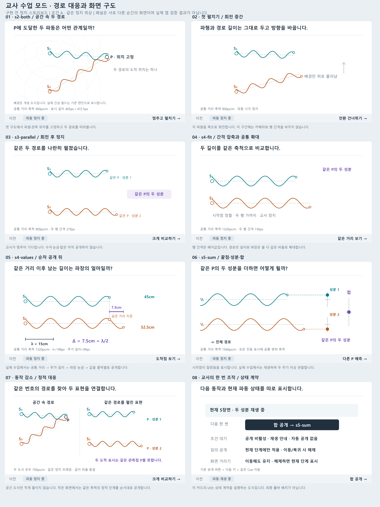
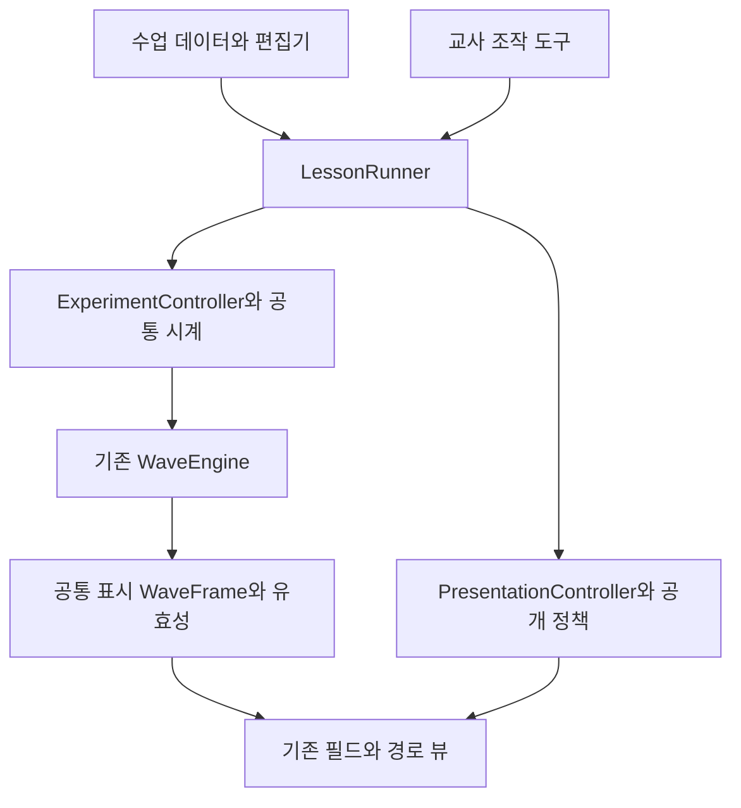

# 간섭 교육앱 교사 수업 모드 설계

기존 간섭 시뮬레이터에 수업 순서와 화면 연출을 더해, 교사가 같은 실험을 계속 조작하면서 설명을 진행하는 인터랙티브 슬라이드 쇼를 만든다. 화면을 넘길 때마다 실험을 다시 만드는 대신, 같은 파동·경로·관측점 P를 유지하고 지금 살펴볼 대상의 배치와 정보 공개 범위를 바꾼다.

핵심 장면은 **공간 속 경로 강조 → 파원을 축으로 나란히 펼치기 → 교사의 설명을 위한 정지 → 공통 확대 → 경로차 공개 → 같은 P의 성분과 합 관찰**이다. 모든 교육적 정지 지점은 교사가 넘긴다. 전환 애니메이션이 끝나도 다음 설명 단계로 자동 진행하지 않는다.

설계 기준일은 2026년 10월 10일이다. 구현 기준은 [Cho-WH/interference의 234e00a](https://github.com/Cho-WH/interference/tree/234e00a2c38523245b07f9f96a42ff48a667ee69)이며, 아래의 새 모듈과 API는 구현 제안이다. 기존 구현과 추가해야 할 부분을 구분한다. 수업 대상은 중고등학교의 동위상·등진폭 두 파원 간섭이며, 기본 수업은 약 12~15분이다.

## 1 제품 결정과 범위

**하나의 실험 인스턴스 위에 하나의 수업 진행기를 둔다.** 슬라이드는 독립된 문서 페이지보다 ‘현재 실험을 어떤 구도와 공개 상태로 볼 것인가’를 기록한 장면이다. 장면 안에는 여러 공개 단계가 있고, 교사는 다음·이전으로 한 단계씩 진행한다.

| 구분 | 첫 교사 모드에서 제공할 것 |
| --- | --- |
| 기본 수업 | 8장면의 완성된 시나리오, 발문, 예측과 확인, 전체 현상으로 복귀 |
| 화면 연출 | 경로의 연속적인 펼침과 접힘, 공통 확대, 배경 퇴장, 초점 강조, 순차 공개 |
| 수업 조작 | 다음·이전, 장면 목록, 물리 재생·정지, 연출 반복, 결과 공개, 자유 조작과 수업 복귀 |
| 교사 편집 | 질문과 메모, 정지 지점, 공개 순서, 예제 조건, 허용 조작, 연출 속도 프리셋 |
| 저장 | 버전이 있는 수업 JSON, 브라우저 내 저장, 파일 내보내기와 가져오기 |
| 후속 확장 | 별도 교사 창, 학생 탐구 실행기, 필요한 경우 짧은 시간 기록 |

첫 버전의 편집기는 수업용 장면 템플릿을 조합한다. 교사가 좌표·애니메이션 곡선·임의 스크립트를 직접 작성할 필요는 없다. 계정, 학급 관리, 채점 서버, 범용 발표 편집기는 이 설계의 첫 구현 범위에 넣지 않는다.

학생용 확장을 위해 질문·허용 조작·공개 조건을 수업 데이터에 함께 두되, 교사 모드 완성을 학생 답안 수집 기능에 종속시키지 않는다.

## 2 기존 기능과 재사용 경계

현재 앱은 TypeScript·Vite, WebGL2와 CPU Canvas 필드, SVG 경로·조작점, HTML 조절기로 구성되어 있다. 외부 런타임 라이브러리는 현재 없다. [현재 구조](https://github.com/Cho-WH/interference/blob/234e00a2c38523245b07f9f96a42ff48a667ee69/docs/architecture.md)

| 기존 요소 | 현재 계약 | 교사 모드의 연결 방식 |
| --- | --- | --- |
| `WaveEngine`와 `WaveFrame` | 물리 진행·명령과 같은 시각의 읽기 프레임 분리 | 그대로 사용한다. 슬라이드마다 엔진을 생성하지 않는다. |
| `advanceTo`, `read`, `samplePaths` | 단조 증가 시각, 경로 단면과 끝값 대응 | 공통 표시 프레임을 필드·경로·P의 국소 진동·성분·합에 배포한다. |
| `setWavelength`, `setSourceTargets`, `settle` | 전파를 포함한 조건 변경과 명시적 즉시 정착 | 추출할 `ExperimentController`를 통해 호출한다. 명령 출처와 전파 정책을 명시하며 연출 코드가 직접 호출하지 않는다. |
| `createClock` | 재생·정지·배속·초기화 | 유일한 물리 시계로 유지한다. |
| `interpolatePathPlacement`, `placePathPoint` | 길이를 보존하는 경로 회전·이동과 점 배치 | 펼치기의 실제 기하 계산을 재사용한다. |
| `createComparisonView` | 경로, 거리, 눈금, 성분, 합을 SVG로 표시 | 의미별 공개 옵션과 외부 배치 입력을 추가한다. |
| `createFieldView`, `createFieldSurface` | 필드 표시, 손잡이, GPU와 CPU 대체 | 배경·거리표시·손잡이·국소 진동의 공개와 입력 허용을 분리한다. |
| `createDisplacementMarker`, `createWavelengthRuler` | 공통 변위 표시와 파장 눈금 | 확대된 무대와 P의 국소 진동에도 같은 표현 요소를 사용한다. P의 위치 손잡이를 변위 표시로 사용하지 않는다. |
| `bindFieldInput`, `probe-region`, `probe-detent` | P와 파원 입력, 허용 영역, 간섭선 걸림 | 입력 정책과 무대 좌표 변환을 연결한다. 예측 중 걸림은 끄고, 교사 모드의 물리적 P 허용 영역을 카메라와 분리한다. |
| `frame-cadence`, `field-quality`, `AppSession` | 샘플 빈도·부하 대응·자원 해제 | 그대로 연결하고 교사 모드 자원도 같은 수명 안에 둔다. 물리 프레임 교체와 연출 자세 보간은 분리한다. |

실제 공개 계약은 [엔진](https://github.com/Cho-WH/interference/blob/234e00a2c38523245b07f9f96a42ff48a667ee69/src/physics/engine.ts), [배치](https://github.com/Cho-WH/interference/blob/234e00a2c38523245b07f9f96a42ff48a667ee69/src/geometry/layout.ts), [비교 뷰](https://github.com/Cho-WH/interference/blob/234e00a2c38523245b07f9f96a42ff48a667ee69/src/views/comparison.ts)를 기준으로 한다.

현재는 `app/main.ts` 안에 명령 처리와 프레임 배포가 있고, 펼침 진행도에 따라 보조 표시가 묶여 나타난다. 외부에서 호출하는 교사 모드 API, 독립된 성분·합 공개, 장면별 카메라, 수업 저장은 추가해야 한다. `AppSession`은 정리와 진단용이며 실험 복원용 저장소가 아니다.

추출 대상은 기존 함수 전체가 아니라 공통 책임이다. 현재 `dispatch`에는 일반 모드의 `constrainProbe`와 `view.changeMode === 'instant'`일 때의 자동 `settle()`이 들어 있다. 이를 그대로 교사 명령에 적용하지 않는다. 정규화·시계 진행·엔진 명령은 공유하고, 일반/교사 모드의 입력 영역과 전파 정책은 §10에서 정한 출처별 정책으로 전달한다. 일반 모드에서 사용한 ‘변화 과정 생략’ 설정이 교사 수업에 조용히 이어지지 않게 한다. [기존 명령 경계](https://github.com/Cho-WH/interference/blob/234e00a2c38523245b07f9f96a42ff48a667ee69/src/app/main.ts#L83)

## 3 화면과 물리에서 유지할 규칙

### 같은 대상과 같은 시각

파원 1은 청록 계열, 파원 2는 주황 계열, 합은 보라 계열을 유지한다. 배경 명도에 맞추어 색의 밝기는 바꿀 수 있지만 번호·색 계열·행 순서는 고정한다. 긴 경로가 바뀌어도 두 행을 맞바꾸지 않는다.

공간 경로, 펼친 경로, 성분점과 합성점은 하나의 `WaveFrame`에서 나온다. 전환 중 다른 시각의 배경과 경로를 섞지 않는다. 각 파원 강조는 표시 강조이며 파원을 끄는 명령이 아니다.

### 펼치기와 확대

모바일 보완: 폭 700px 미만의 무대에서는 아래 공통 확대를 생략하고 행 배치만 조정한다. 공간 보기부터 펼치기·분석·도착점 비교·복귀까지 거리·변위 축척과 파형·표식 크기를 고정한다. A/B/C 조건 전환도 화면 배율을 바꾸지 않는다. 화면 회전이나 창 크기 변경은 새 화면에 맞는 공통 축척을 적용한다.

첫 펼치기 동안 실제 표시 선분은 회전·이동만 한다. 길이와 파장 크기는 그대로다. 그 다음 별도의 확대 단계에서 두 경로에 하나의 거리 축척 `px/m`를 적용한다. 화면을 채우려고 두 경로를 각각 다른 너비로 늘리지 않는다.

현재 앱은 창 크기 변경 외에는 공통 거리 축척을 고정한다. 교사 모드에는 **명시적 카메라 확대 단계에서도 공통 축척을 변경할 수 있다**는 예외를 추가한다. P 이동·파장 변경·첫 펼치기는 축척을 바꾸지 않는다. 숨겨진 공간 뷰도 같은 카메라 상태를 보유하며, 다시 등장할 때 두 표현의 축척이 일치한다. 기존 [시각화 계약](https://github.com/Cho-WH/interference/blob/234e00a2c38523245b07f9f96a42ff48a667ee69/AGENTS.md)에 이 교사 모드 예외를 명시한다.

거리 축척과 변위 축척은 서로 다른 물리량이다. 두 경로에는 같은 거리 축척, 모든 파형과 세 진동 표시에는 같은 변위 축척을 각각 적용한다. 파형의 변위를 거리와 같은 물리적 공간 높이로 해석하게 만들지 않는다.

행 사이의 간격은 두 그림을 배치하는 화면값이며 파원 간격이나 경로 길이를 나타내지 않는다. 첫 회전 뒤 행을 가까이 모을 때에는 이 배치값만 줄인다. 경로 내부의 거리와 파장 간격은 공통 축척으로 보존한다. 펼친 화면에는 ‘가로는 경로를 따라간 거리, 세로는 변위’와 정지·재생 상태를 표시한다. 파형은 같은 순간의 위치별 변위이며 물 입자가 지나간 궤적이나 시간 그래프가 아니다.

### 두 끝점의 의미

펼쳐진 두 끝점은 서로 다른 장소가 아니라 **같은 P에서 두 파원이 만드는 성분**이다. 장면 3~5에서 ‘같은 P의 두 성분’ 안내를 지속한다. 실제 길이가 다른 두 경로 끝을 억지로 같은 열에 맞추지 않는다. 끝값 비교 단계에서 수평 점선으로 두 성분점을 같은 열에 연결하고, 그 오른쪽 중간 높이에 합성점을 둔다. 끝점·성분점·국소 합성변위 표시는 각자의 0선으로부터 읽고, 화면의 절대 높이로 서로의 변위를 비교하지 않는다.

공간 화면의 P 손잡이는 관측 위치를 나타내므로 물리적 진동과 무관하게 고정된다. 장면 1의 진동 관찰에는 P 중심을 통과하는 작은 0선과 국소 합성변위 표시 `local-probe-result`를 사용한다. 막대를 옆으로 분리하지 않고 P를 0점으로 하여 그 위에 겹쳐 그린다. 기존 `createDisplacementMarker`와 현재 프레임의 합성변위를 재사용하며, P의 좌표를 흔들어 진동처럼 보이게 하지 않는다. 표시는 포인터 입력을 통과시켜 P 손잡이 조작을 보존한다. 펼친 합성점은 같은 값을 보여주는 다른 배치이고, 예측 시 두 표시를 함께 가린다.

### 정지와 정상 상태

`다음·이전`은 수업 순서, `재생·일시 정지`는 물리 시간, `전환 다시 보기`는 화면 움직임을 담당한다. 일반 단계 전환은 재생 상태를 유지한다. 기본 수업의 첫 펼치기는 교사가 **멈추고 펼치기**를 선택하는 명시적 복합 동작으로 제공하며, 펼친 뒤 자동 재생하지 않는다.

정상 상태에서만 경로차를 단일 파장과 비교한다. P의 간섭 해석은 `probe-steady`, 경로 위 파장 비교는 고정된 수업 해석 범위의 `analysis-steady`를 따른다. 실제 근거와 범위는 §15에 정의한다. 화면 전체의 정상 여부와 특정 P 또는 경로의 해석 가능성을 혼동하지 않는다. 순간 합성변위가 0인 한 프레임을 완전 상쇄로 설명하지 않으며 적어도 두 주기를 관찰한다. 파장 변경 중의 판정 유보는 기존 [물리 모델](https://github.com/Cho-WH/interference/blob/234e00a2c38523245b07f9f96a42ff48a667ee69/docs/physics-model.md)을 따른다.

## 4 수업 단위와 화면 구성

| 단위 | 의미 | 예 |
| --- | --- | --- |
| 수업 `Lesson` | 목표와 예제, 장면들을 묶은 저장 단위 | 경로차로 간섭 설명하기 |
| 예제 `ExperimentPreset` | 파원·P·파장 등 실험 조건 | 경로차가 반 파장인 조건 A |
| 장면 `Scene` | 한 가지 설명 목적과 기본 구도 | 두 경로를 나란히 보기 |
| 단계 `Cue` | 교사가 한 번 진행해서 도달하는 공개 상태 | 경로차만 표시하기 |
| 전환 `Transition` | 두 단계 사이의 짧은 움직임 | 회전, 배경 퇴장, 공통 확대 |

학생에게 보이는 무대와 교사의 조작부를 분리한다. 무대에는 한 가지 질문, 현재 필요한 시각화, 짧은 범례만 둔다. 하단 조작부는 작은 높이로 예약하여 파형 위를 가리지 않으며, 전체 화면에서는 필요할 때 나타나게 한다. 키보드 초점이 있을 때는 숨기지 않는다. 도구가 숨겨져도 예약 영역의 높이는 바뀌지 않아 무대가 출렁이지 않는다.

장면 표시는 `3 / 8 · 같은 두 경로 펼치기`, 다음 동작은 `다음 · 크게 비교하기`처럼 표현한다. 이 다음 동작 문구를 가진 버튼이 현재 단계의 주 동작이다. 연출 중에는 같은 버튼이 `전환 건너뛰기`가 된다. 재생 여부는 별도의 `파동 정지 중` / `파동 재생 중` 표시로 구분한다. 내부 용어인 엔진·프레임·렌더러는 학습 화면에 나타내지 않는다.

### 무대 구도 프리셋

| 구도 | 중심 대상 | 배치 규칙 |
| --- | --- | --- |
| 전체 현상 | 파동 필드 | 안전 여백을 제외한 무대 대부분을 채운다. |
| 공간 경로 | S₁·S₂·고정 위치 P와 두 경로 | 세 점과 파형의 최대 변위를 포함한 범위로 가까이 본다. P 위치와 국소 합성변위 표시는 구별한다. |
| 제자리 펼침 | 파원에 붙어 회전한 두 경로 | 첫 회전 중 카메라와 축척을 고정한다. 시작점과 두 행 사이 간격도 유지한다. |
| 길이 비교 | 시작점을 맞추고 간격을 좁힌 두 행 | 행 간격을 배치값으로 조절한 뒤 긴 경로와 보조 표시가 들어갈 공통 배율을 적용한다. |
| 도착점 비교 | 두 성분과 합성점 | 경로 끝과 연결선을 남기고 세 표시를 크게 본다. 전체 경로가 잘리면 잘림을 표시한다. |
| 전체로 복귀 | 원래 공간의 두 경로와 필드 | 확대를 풀고 원래 파원 위치로 돌린 뒤 접으며 하나의 고정 위치 P로 다시 모인다. |

권장 기준 화면은 1280×720 CSS px다. 질문 30~40px, 핵심 값 26~32px, 파원·P 라벨 20~24px, 조작 18~20px부터 조정한다. 현재 자유 탐색 화면보다 교실 투사에 맞게 키우는 설계값이며 실기기 검증이 필요하다. 부가 텍스트를 줄여 **질문과 조작부를 제외한 무대의 약 80% 이상**을 현재 시각화에 사용한다. 전체 화면 면적을 기계적으로 채우려고 글자·안전 여백·경로를 찌그러뜨리지 않는다.

### 화면 비율별 배치와 충돌 처리

아래 수치는 첫 제작의 기준값이다. 좌표 단위는 CSS px이며, 실제 글꼴의 글자 경계와 파형 최대 변위를 포함해 적합 여부를 검사한다. 안전 영역 밖으로 나간 P를 물리 좌표 변경으로 해결하지 않는다.

| 화면 | 질문 영역 | 시각화 안전 영역 | 조작 영역과 축소 우선순위 |
| --- | --- | --- | --- |
| 1280×720, 16:9 | x=64~1216, y=20~96 | x=64~1216, y=112~648 | y=664~720. 다음·이전·재생 유지, 부가 도구는 메뉴에 둔다. |
| 1024×768, 4:3 | x=40~984, y=20~104 | x=40~984, y=120~680 | y=704~768. 수평 여백과 연결선 길이를 먼저 줄이고, 경로 공통 배율을 재계산한다. |
| 1280×600, 낮은 높이 | x=48~1232, y=12~84 | x=48~1232, y=100~520 | y=544~600. 보조 문구를 접고 행 간격을 최소 안전 간격까지 줄인다. |
| 너비 900px 미만 | 질문은 최대 두 줄로 유지 | 해당 구도의 두 경로를 같은 축척으로 함께 유지 | 도구는 한 줄의 주 동작과 펼침 메뉴로 바꾼다. 길이 비교와 도착점 상세를 순차 화면으로 나누며 한 경로만 따로 확대하지 않는다. |

충돌은 ① 메모·단축키 도움말 등 보조 UI 접기 → ② 라벨을 정해진 바깥 앵커로 이동 → ③ 반복 눈금의 숫자만 생략하고 기준 눈금·단위 유지 → ④ 화면 밖 여백과 행 간격 조정 → ⑤ 두 경로의 공통 배율을 함께 낮추기 순으로 해결한다. 경로 시작·끝, 같은 거리의 대응점, 추가 길이 양끝, 필요한 0선은 생략하지 않는다. 조작부·질문·파형을 겹쳐 놓거나 글자를 최소 읽기 크기 아래로 줄여 맞추지 않는다. 이 조건을 만족할 수 없으면 도착점 상세를 별도 Cue에서 보여 주고 `전체 경로` 복귀를 제공한다.

16:10과 4:3에서는 여백과 질문 위치를 바꾸고 길이·끝값 대응을 유지한다. 새 레이아웃이 P를 화면 밖으로 밀어낸다면 카메라를 넓히거나 축척을 함께 조정한다. **장면 전환이나 창 크기 변경 때문에 P의 물리 좌표를 조용히 바꾸지 않는다.** 현재 자유 탐색의 `constrainProbe` 적용 정책과 구별해야 한다.

### 투사와 직접 조작

투사 기본 테마에는 단색 배경, 파원별 색과 번호, 주요 경로 3px 이상, 보조선 2px 이상을 시작값으로 둔다. 선 두께는 확대 배율과 별개로 읽을 크기를 유지한다. 두 파형은 색뿐 아니라 S₁/S₂와 고정 행 순서로도 구별한다. 읽기에 필요한 그래픽·조작 상태는 인접 배경과 3:1 이상, 일반 본문은 4.5:1 이상을 기준으로 검사한다. 대비 수치를 만족해도 밝은 교실의 투사 판독성까지 보장되지는 않으므로 뒷자리 확인을 별도로 한다.

주요 버튼과 손잡이의 실제 입력 영역은 44×44px 이상을 목표로 한다. 작은 시각적 P 점에도 같은 중심의 더 큰 투명 입력 영역을 제공하며, 근처 파원 입력 영역과 겹치면 가장 가까운 대상 표시 및 키보드 대안을 둔다. 글자 크기와 클릭 영역 크기를 혼동하지 않는다. Tab 초점은 가시적인 테두리로 표시하고, 접힌 도구를 열고 닫으면 조작을 시작한 버튼으로 초점을 돌린다. [W3C 비텍스트 대비](https://www.w3.org/WAI/WCAG22/Understanding/non-text-contrast.html), [텍스트 최소 대비](https://www.w3.org/WAI/WCAG22/Understanding/contrast-minimum.html), [포인터 목표 크기](https://www.w3.org/WAI/WCAG22/Understanding/target-size-minimum.html)

## 5 기본 수업 시나리오

수업 질문은 **두 파동이 모두 도착하는데 왜 P는 진동하지 않을까**이다. 목표는 학생이 ‘두 경로의 공통 길이 → 남는 길이를 파장으로 비교 → P에서 두 성분의 위상 관계 → 합성 진동’을 자기 말로 연결하는 것이다. 파원은 같은 진동수·같은 초기 위상이며 P에 도착한 두 성분의 진폭은 같다. 이 모델 조건은 시작 안내와 마지막 조건식에 학생용 문구로 표시한다. 파장 변경 직후의 과도 상태와 정상 상태를 구분한다.

| 장면과 예상 시간 | 학생이 볼 것 | 교사의 진행과 발문 |
| --- | --- | --- |
| 1 전체 현상 1분 | 전체 파동과 조건 A의 P. 수치·경로·공식은 숨기고 P의 국소 합성변위를 0선과 함께 표시한다. | 파동 관찰 → P 강조와 진동 확인. ‘P의 원은 관측 위치이고, P를 기준으로 움직이는 보라색 점과 막대가 그곳의 진동을 나타낸다.’ “주변에는 변화가 있는데 이 지점의 합은 시간이 지나도 어떨까?” |
| 2 두 경로 1분 30초 | 같은 공간에서 경로 1, 경로 2, 두 경로와 P의 각 성분을 차례로 강조한다. | 파원은 계속 작동한다. “P의 합이 움직이지 않으면 두 파동이 도착하지 않은 걸까?” 두 성분은 각각 계속 진동함을 확인한다. |
| 3 제자리 펼침 1분 30초 | 같은 순간을 멈춘 뒤 경로가 파원 주위로 회전하고 배경만 위로 물러난다. | ‘멈추고 펼치기’ → 정지. “거리를 바꿨을까, 같은 경로를 펼쳤을까?” 같은 P의 두 성분 안내를 유지한다. |
| 4 길이 비교 2분 | 두 행을 가까이 모아 공통 확대. 같은 거리의 대응점, 추가 길이, 파장 눈금, 값이 순서대로 나타난다. | ‘크게 비교’ → ‘같은 거리’ → ‘남는 길이’ → ‘파장 눈금’ → ‘수치 확인’. “같은 거리까지의 파형은 어떤 관계일까? 거기서 반 파장을 더 가면?” |
| 5 도착과 합 2분 | 경로 끝에서 두 성분점으로 연결. 교사의 재생 뒤 합성점 공개. | ‘도착점 보기’ → ‘성분 재생’ → ‘합 공개’. 적어도 두 주기를 관찰한다. “추가 반 파장과 두 성분의 반대 움직임은 어떻게 연결될까?” |
| 6 다른 P 예측 2분 | 현재 P로 공간 복귀 후 B의 P와 두 경로 위 파형을 유지한다. 펼친 뒤 거리와 파장을 공개하며 합성 진동만 가린다. | 현재 경로 접기 → 파동 배경을 유지하며 P를 B로 이동 → 정지 → 제자리 펼침 → 정지 → 확대·예측 대기 → 경로와 성분 확인 → 합 공개. “한 파장 차이면 더 많이 상쇄될까?” |
| 7 같은 P에서 파장 변경 2분 | 조건 A로 돌아와 P와 경로차 7.5cm를 유지. 예정 파장 7.5cm를 알리고 예측 후 실제로 바꾼다. | ‘조건 A로’ → 예측 → ‘파장 절반으로’ → 가린 채 전파 대기 → 경로와 성분 확인 → 합 공개. “거리차가 같아도 파장에 대한 비율이 달라지면?” |
| 8 전체로 복귀 1분 | 같은 P로 접혀 돌아가는 경로, 전체 무늬, 마지막에 모델 전제와 조건식. | “처음 보는 점의 진동을 무엇으로 예상할까?” 1.5λ의 짧은 새 사례를 말로 설명한 뒤 조건식 공개. 이어서 자유 조작 가능. |

시간은 수업 운영의 참고값이다. 타이머가 장면을 자동으로 넘기거나 학생의 발화를 재촉하지 않는다. 첫 수업은 현상을 먼저 보고 이유를 설명하는 흐름이며, 6·7장면에 예측을 둔다.

### 클릭 단계와 학생이 확인할 관계

각 ID는 §12의 `CueSpec.id`로 사용한다. 표의 각 단계에 도착하면 자동으로 다음 단계로 가지 않는다. ‘성분 재생’만 교사가 선택한 명시적 재생 동작이며, 물리 재생·정지는 언제든 별도 도구로 조절한다. 예제 문맥 A/B/C의 경계와 직접 점프 규칙은 §11을 따른다.

| 단계 ID | 도착 화면과 한 번의 조작 | 문맥과 확인할 관계 |
| --- | --- | --- |
| `s1-field` → `s1-probe` | 전체 파동 → P와 국소 합성변위 공개 | A. 관찰 위치와 그곳의 진동을 구별한다. 합성변위가 계속 0인 것을 본다. |
| `s2-path1` → `s2-path2` → `s2-both` | 성분 1 강조 → 성분 2 강조 → 둘 함께 | A. 한 성분만 강조해도 물리적으로 다른 파원을 끄지 않는다. 각 진동은 존재한다. |
| `s3-parallel` | 멈추고 제자리 펼치기, 도착 후 정지 | A. 같은 순간·같은 길이·같은 P를 다른 배치에서 본다. |
| `s4-fit` → `s4-common` | 가까이 모아 크게 비교 → 짧은 경로 끝과 긴 경로의 같은 거리 대응점 표시 | A. 동위상 파원이므로 같은 거리에서의 파형이 일치한다. 대응점은 새로운 관측점이 아닌 거리 비교 표식이다. |
| `s4-extra` → `s4-ruler` → `s4-values` | 추가 구간 강조 → λ 눈금 → 45cm·52.5cm·7.5cm와 비율 | A. 더 간 반 파장이 한 주기의 절반 차이를 만든다. 현재 단면에서 읽은 관계를 다음 장면의 움직임으로 확인한다. |
| `s5-endpoints` → `s5-components-playing` → `s5-sum` | 끝점 연결 → 성분 재생 → 합 공개 | A. 두 성분은 계속 반대 위상으로 움직이고 합은 계속 0이다. |
| `s6-b-predict` → `s6-b-paths` → `s6-b-sum` | 조건 B에서 예측 → 경로·성분 확인 → 합 공개 | B. 경로차 λ는 한 주기 차이여서 같은 위상이다. 공개 전에는 §9의 가림 적용. |
| `s7-a-predict` → `s7-c-change` | 조건 A와 예정 새 파장으로 예측 → 파장을 절반으로 변경 | A → C. 변경 직후는 과도 상태이며 새 조건의 정상 간섭을 바로 판정하지 않는다. |
| `s7-c-paths` → `s7-c-sum` | 해석 범위가 정상인 뒤 교사가 경로·성분 확인 → 합 공개 | C. 같은 7.5cm가 이제 한 파장이므로 보강이다. |
| `s8-field` → `s8-rule` | 전체로 복귀 → 학생 설명 후 조건식 | C 유지. 예를 들어 경로차 1.5λ는 한 주기에 반 주기가 더해져 반대 위상이라고 설명한다. 이 구두 문제는 엔진 조건을 바꾸지 않는다. |

장면 4의 같은 거리 표식은 짧은 경로의 끝에서 긴 경로의 동일한 거리 위치로 대응선을 연결한다. 추가 구간은 실제 긴 경로 끝까지이며, 애니메이션이 새 파동을 이동시키는 것처럼 보이지 않도록 정지한 파형 위에서 강조 영역만 공개한다. 반 파장이라는 수치는 학생이 먼저 파형과 눈금으로 읽은 뒤 확인한다.

### 기대하는 설명과 다시 보여줄 장면

교사 메모에는 정답 문장 하나보다 학생이 사용해야 할 근거와 필요한 재관찰을 둔다. 아래 확인은 수업 중 구두 문답이며, 첫 버전에 자동 채점이나 답안 제출을 요구하지 않는다.

| 장면 | 기대하는 학생 설명 | 흔한 오해와 교사의 대응 |
| --- | --- | --- |
| 1~2 | 두 성분은 도착해 각각 진동하지만 합은 진동하지 않는다. | ‘파동이 도착하지 않았다’면 성분 1·2를 다시 강조하고 국소 합과 연결한다. |
| 3 | 경로를 돌려 배치했을 뿐 길이와 관측점은 같다. | ‘P가 두 곳으로 나뉘었다’면 같은 ID와 연결선을 짚거나 같은 프레임에서 접기를 다시 보여준다. |
| 4 | 공통 거리까지는 같고 추가 반 파장 때문에 끝에서 반대 위상이 된다. | ‘전체 길이가 다른 것’만 말하면 같은 거리 대응점부터 추가 구간을 손으로 짚어 설명하게 한다. |
| 5 | 두 성분이 매 순간 반대여서 더한 값은 계속 0이다. | ‘지금 둘 다 0이다’면 재생해 변위가 큰 순간과 0을 지나는 순간을 함께 본다. |
| 6 | 추가 한 파장은 한 주기이므로 같은 위상으로 만난다. | ‘더 먼 만큼 더 많이 상쇄된다’면 A의 반 주기와 B의 한 주기를 비교한다. 재방문 때 조건이 바뀜을 버튼에서 알린다. |
| 7 | 같은 경로차라도 λ가 달라지면 Δr/λ가 달라진다. | ‘P가 같아 결과도 같다’면 7.5cm에 들어가는 반 파장·한 파장을 읽게 한다. |
| 8 | 정수 주기 차이는 같은 위상, 반 주기를 더한 차이는 반대 위상이다. | 식만 외워 답하면 1.5λ를 한 주기와 반 주기로 나누어 설명하게 한다. |

마지막 화면에는 ‘두 파원은 같은 진동수·같은 초기 위상, 도착 진폭은 같음, 변화가 도착한 정상 상태’와 함께 `Δr = mλ → 보강`, `Δr = (m + 1/2)λ → 완전 상쇄`를 표시한다. 여기서 `Δr = |r₂ − r₁|`, `m = 0, 1, 2, …`다. 실제 적용 범위는 파원 간격과 P가 만들 수 있는 경로차에 한정된다. 모델 전제가 달라질 때에도 그대로 쓰는 무조건적인 규칙으로 소개하지 않는다.

예측 뒤 근거를 말하게 하고 오해에 따라 다시 관찰하게 하는 운영은 [PhET 수업 진행 전략](https://phet.colorado.edu/assets/virtual-workshop/Facilitation_Strategies.pdf)을 참고한다. 이 수업의 효과는 §17의 짧은 사용 관찰에서 별도로 확인한다.

### 예제의 수치와 실제 배치

현재 기본 파원 위치 S₁=(0.4, 0.21)m, S₂=(0.4, 0.51)m와 간격 0.30m를 사용한다. 아래 P는 이 위치에서 두 거리 조건을 만족하도록 계산한 좌표다. 화면 표시는 cm, 저장과 엔진 입력은 m로 한다.

| 예제 | P 좌표 m | 파장 | 두 거리 | 경로차와 결과 |
| --- | --- | --- | --- | --- |
| A | (0.8491202337626307, 0.238125) | 15cm | 45cm, 52.5cm | 7.5cm = λ/2, 완전 상쇄 |
| B | (0.8357106264483345, 0.0975) | 15cm | 45cm, 60cm | 15cm = λ, 보강 |
| C | A와 같음 | 7.5cm | A와 같음 | 7.5cm = λ, 보강 |

좌표와 거리는 기하 계산으로 대조했다. 구현 시에는 기존 엔진 판정과 각 지원 무대의 입력 영역으로 다시 확인한다. 저장에는 충분한 정밀도를 유지하고, 반올림한 화면 값을 다시 물리 입력으로 쓰지 않는다.

장면 6은 현재 P로 경로를 접어 공간으로 복귀한 뒤, 별도 조작으로 B를 적용한다. 기본 A/B는 파원과 파장이 같으므로 P만 이동한다. 교사가 A의 입력을 바꿨다면 공간 복귀까지는 그 입력을 유지하고, B로 진입할 때 저장된 B 조건을 적용한다. 이동·펼침·예측에서 두 경로 위 파형은 유지한다. 파동 배경은 P 이동 중과 이동 후에 남겨 두고, 펼치기를 시작할 때 연속적으로 물린다. 별도의 합성 변위 표시는 계속 가린다. 각 단계 사이에는 수동 정지를 둔다. 장면 7의 예측 단계는 A, 변경 이후는 C 문맥이다. 변경은 기존 엔진의 `setWavelength(0.075)`에 연결하되 §10의 수업 명령 정책으로 실제 전파를 기본 적용한다. 문맥을 넘나들어도 시각은 0으로 되돌리지 않는다. 교사가 별도 ‘변화 과정 생략’을 선택한 경우에만 `settle()`을 사용하고 그 선택을 표시한다.

## 6 핵심 전환의 연출 명세

### 첫 펼치기

입력은 현재 프레임 F, 그 프레임의 경로 샘플, 현재 공간 배치, 공개 상태다. 먼저 공통 시계를 누른 순간까지 진행한 뒤 정지하고, F를 새로 읽는다. 마지막으로 렌더링된 오래된 필드만 붙잡아 경로와 시각이 어긋나지 않게 한다.

| 구간 | 화면 동작 | 보존할 것 |
| --- | --- | --- |
| 0~180ms | 두 경로와 끝점을 선명하게 만들고 배경 대비를 낮춘다. | 경로의 위치·길이·파형 샘플 |
| 180~1180ms | 각 경로를 자기 시작점 주위로 회전하여 수평으로 만든다. | 시작점, 거리 축척, 변위 축척, 파원 ID |
| 260~1080ms | 필드 배경만 불투명도 1→0, 위쪽으로 무대 높이의 약 8% 이동, 흐림 0→6px | 파형·끝점·라벨에는 흐림을 적용하지 않음 |
| 1180~1360ms | ‘같은 P의 두 성분’ 안내를 드러낸다. | 서로 다른 장소로 오해하지 않는 대응 |
| 이후 | 나란해진 두 경로와 안내를 유지하고 교사 입력을 기다린다. | 숫자·눈금·합성결과는 아직 숨김 |

시간과 흐림 수치는 첫 제작의 시작값이다. 느리게·보통·빠르게 프리셋으로 함께 조절하고 교실에서 경로를 따라갈 수 있는지 확인한다. 회전의 끝에서 튀는 반동이나 탄성은 사용하지 않는다. 안내는 자동으로 사라지는 알림이 아니라 장면 3~5의 고정 범례다.

현재 기본 파원은 같은 x좌표에 있으므로 각 파원을 축으로 회전하면 시작점 정렬도 자연스럽게 유지된다. 다른 배치를 지원할 때에는 회전 후 두 행을 옮겨 시작점을 맞추는 동작을 분리한다. 회전과 정렬을 하면서 길이를 줄이거나 새 파형으로 교체하지 않는다.

### 다음 클릭의 공통 확대와 행 간격

‘크게 비교하기’는 **두 경로 사이의 간격 조정과 공통 확대**다. 첫 회전에서 남겨 둔 실제 파원 간격을 화면상의 행 간격으로 계속 사용할 필요는 없다. 행의 0선 사이 간격 `rowGapPx`는 비교 구도의 배치값이며, 두 파원 사이 실제 거리나 추가 경로 길이가 아니다. 이를 변경해도 실험 조건은 바뀌지 않는다.

650~900ms 동안 두 행의 시작 x좌표를 함께 옮기고 두 경로의 거리 축척을 같은 값으로 보간한다. 두 행의 y좌표는 목표 간격까지 따로 이동할 수 있다. 각 경로의 표시 길이는 매 순간 `실제 경로 길이×그 순간의 공통 거리 축척`이다. 변위 축척도 두 파형과 세 진동 표시에 공통으로 적용하며, 거리 축척과는 별도의 값으로 관리한다. 그룹 전체를 CSS로 늘려 행 간격·글자까지 함께 확대하지 않는다.

행 간격의 최소값은 두 파형의 최대 표시 변위와 사이 눈금 띠의 높이, 라벨 여유를 합해 계산한다. 예를 들어 각 파형의 최대 변위가 약 35px, 눈금 띠가 48px, 여유가 양쪽 16px이면 최소 간격은 약 150px다. 긴 경로·성분 표시 예약 공간·최대 변위가 들어가는 배율을 계산하고, 화면 높이가 부족하면 두 행에 같은 거리·변위 축척을 적용해 함께 낮춘다. 파형의 위상에 따라 순간 변위가 작다는 이유로 행 간격을 줄였다 늘리지 않는다.

공통 거리, 추가 길이, 파장 눈금, 수치는 180~280ms의 짧은 공개 전환을 사용한다. 각 공개 뒤에는 무기한 대기한다. `s4-common`에서는 짧은 경로의 끝과 긴 경로 위 같은 거리의 지점을 연결한다. `s4-extra`에서는 그 지점 이후 실제 도착점까지의 추가 구간을 강조하며, 연결선이 도착점 자체와 같은 위상이라는 인상을 주지 않는다. 경로차 음영은 두 경로 사이의 좁은 눈금 띠에 두어 파형을 가리지 않는다.

### 장면 2~5의 화면 스토리보드



그림은 조건 A의 같은 정지 위상을 각 전환 구도에 배치한 설계 도식이다. 패널별 화면은 순서대로 나타나는 장면이며, 배경 간섭 필드의 실제 렌더링·입력 동작·전환 성능은 구현에서 확인한다.

다음은 조건 A, 1280×720 화면에 대한 **구현 시작용 위치 명세**다. 좌표는 0선·기준선의 앵커이며 진동점의 실제 y좌표는 같은 프레임의 변위를 더해 구한다. 반올림한 화면 좌표를 엔진에 되넣지 않는다. 작은 화면은 §4의 안전 영역에 맞추어 같은 계산으로 다시 배치한다.

| 단계 | 출발 화면 → 중간 동작 → 도착 화면 | 기준 배치와 공개 |
| --- | --- | --- |
| `s2-path1` → `s2-path2` → `s2-both` | 공간 구도를 유지하며 해당 경로의 대비만 순서대로 높인다. 카메라가 클릭마다 뛰지 않는다. | 공통 거리 축척 900px/m. S₁=(320,230), S₂=(320,500), 고정 위치 P≈(724.21,255.31). 경로 표시 길이는 405px/472.5px. 기본 변위 진폭은 24px를 시작값으로 한다. |
| `s3-parallel` | 위 구도 → 같은 시작점 주위 회전·배경 퇴장 → 수평 경로에서 정지. 중간 회전에도 각각 같은 길이를 유지한다. | 축척 900px/m 유지. S₁ 행 0선 y=230, S₂ 행 y=500. 시작 x=320, 끝 x=725/792.5. 숫자·눈금·합을 숨기고 ‘같은 P의 두 성분’을 유지한다. |
| `s4-fit` | 넓은 행 간격 → 간격 압축과 공통 확대 → 두 행 중심의 구도에서 정지. | 시작 x=148, 행 0선 y=282/438, 간격 156px. 공통 축척 1320px/m, 경로 길이 594px/693px, 끝 x=742/841. 두 파형의 기본 표시 진폭은 같은 비율로 약 35.2px. 성분/합 자리 x=970/1108은 아직 빈 예약 공간이다. |
| `s4-common` → `s4-extra` | 먼저 두 행의 같은 거리 지점 연결 → 긴 경로의 남는 구간만 강조. | 공통 거리의 경계 x=742. 아래 행의 실제 끝은 x=841이므로 추가 길이는 99px. 동일 거리의 대응점과 실제 도착점을 서로 다른 표식·짧은 문구로 구별한다. |
| `s4-ruler` → `s4-values` | 같은 구도에서 파장 눈금 → 값 공개. | 이 단계의 λ 한 칸은 198px이고 추가 99px가 반 칸이다. 눈금 띠는 두 0선의 중간 y≈360에 두되 파형·연결선과 겹치지 않도록 라벨을 바깥에 둔다. |
| `s5-endpoints` | 전체 경로 구도 → 끝점과 세 진동 표시의 방향으로 카메라 이동·공통 확대 → 상세 구도. | 예시 공통 거리 축척 1560px/m, 시작 x=-22, 행 y=270/446, 실제 끝 x=680/797. 성분 표시 x=964, 합 x=1116 및 0선 y=358. 최대 표시 진폭은 성분 약 41.6px/합 약 83.2px. 시작점이 안전 영역 밖이면 양쪽 행에 같은 잘림 표시와 `전체 경로`를 제공한다. |
| `s5-components-playing` → `s5-sum` | ‘재생하며 관찰’로 같은 P의 두 성분을 재생 → 교사가 두 주기 이상 관찰한 뒤 ‘합 공개’. | 같은 배치와 변위 축척을 유지한다. 성분 2개는 같은 x열, 합은 그 오른쪽이다. 끝점에서 성분점으로 연결하는 선은 매 프레임 실제 끝값 높이와 일치한다. |

스토리보드의 확대 전후 숫자는 서로 다른 **시간의 화면**이다. 한 화면에서 두 경로를 다른 축척으로 그리지 않으며, 비교용 삽화에 축척이 다른 두 경로를 나란히 놓지 않는다. 세부 구도는 이 위치값을 그대로 하드코딩하기보다 `안전 영역 + 실제 길이 + 최대 변위 + 최소 라벨 크기`의 제약을 만족하도록 계산한다.

### 끝점 집중과 복귀

끝점 집중에서는 공통 카메라를 이동·확대하고 수평 연결선을 드러낸다. 경로가 화면 가장자리에서 잘리는 경우 잘림 표시와 ‘전체 경로’ 복귀 버튼을 제공한다. 일부만 보이는 길이를 전체 거리처럼 제시하지 않는다. 성분점 두 개는 같은 열, 합성점은 그 오른쪽 중간 높이에 둔다. 경로 끝의 표식과 성분점은 같은 파원 번호를 가진다.

복귀는 보조 정보 숨김 → 확대 해제와 원래 파원 위치·간격으로 복귀 → 두 경로 접기 → 배경 복원 순서다. 동일한 프레임을 정지한 왕복에서는 같은 위치·길이·끝값으로 정확히 돌아와야 한다. 재생 중 왕복에서는 물리 시각은 계속 진행하고 동일성은 ID와 현재 프레임으로 유지한다. 화면 가리기 상태는 이러한 복귀로 해제하지 않는다.

### 움직임 규칙과 중단

| 토큰 | 쓰임 | 보통 프리셋 시작값 | 가속·감속 곡선 |
| --- | --- | --- | --- |
| `reveal` | 눈금·값·질문 공개, 짧은 강조 | 220ms, 허용 범위 180~280ms | `cubic-bezier(0,0,0.38,0.9)` |
| `layout` | 행 간격·카메라·끝점 구도 변경 | 기준 780ms, 허용 범위 650~900ms | `cubic-bezier(0.2,0,0.38,0.9)` |
| `path-transform` | 첫 회전과 접기 | 회전 본구간 1000ms. 앞뒤 강조를 포함한 기본 펼치기 1360ms | `cubic-bezier(0.4,0.14,0.3,1)` |
| `background` | 배경 퇴장·재등장 | 해당 경로 변환과 겹치는 820ms | `cubic-bezier(0.2,0,0.38,0.9)` |

느리게는 보통 시간의 1.5배, 빠르게는 0.75배를 시작값으로 한다. 정지 대기 시간과 물리 재생 배속에는 적용하지 않는다. 구도가 크게 달라지는 `layout`은 화면 대각선에 대한 앵커 이동 비율에 따라 허용 시간 범위 안에서 길게 잡고, 기본 수업의 첫 회전은 교육적 대응을 따라가기 위한 고정 기준으로 둔다. 탄성·반동·원근 기울임을 사용하지 않는다. 이는 첫 제작값이며 교실 관찰을 통해 조정한다. 곡선의 참고 근거는 [Carbon Motion](https://www.carbondesignsystem.com/building-blocks/foundations/motion/overview)이다.

전환 중 ‘다음’은 현재 전환을 도착 상태로 완료할 뿐 다음 공개까지 진행하지 않는다. ‘이전’이나 점프는 현재 화면의 자세를 출발점으로 삼아 새 목표로 보간한다. 첫 프레임의 위치·축척·불투명도는 현재 값과 일치시키고, 취소한 전환의 콜백과 물리 명령은 다시 실행하지 않는다. 중단 직후 속도까지 완전히 연속인 전환은 첫 버전의 보장 범위에 넣지 않되, 순간 위치 점프나 반동은 허용하지 않는다. 동작 감소 설정 또는 창 크기 변경 시에는 현재 목표 상태를 즉시 새 안전 영역에 맞춰 적용한다.

### 연출 감소

`prefers-reduced-motion`과 앱의 ‘동작 줄이기’를 반영한다. 회전·확대·배경 이동을 생략하되, 같은 경로의 대응을 설명하는 정적 도식을 제공한다. 교육적 정지와 공개 순서는 유지한다. 물리 시뮬레이션의 재생 여부는 이 설정이 바꾸지 않는다. [브라우저의 동작 감소 설정](https://developer.mozilla.org/en-US/docs/Web/CSS/Reference/At-rules/@media/prefers-reduced-motion)

첫 펼치기의 대체 화면은 왼쪽 ‘공간 속 경로’, 오른쪽 ‘같은 경로를 펼친 표현’이다. 두 도식과 두 경로 모두 **하나의 거리·변위 축척과 같은 프레임 F**를 사용한다. 예를 들어 1280×720에서 거리 축척 700px/m를 사용하면 왼쪽 S₁=(120,230), S₂=(120,440), P≈(434.38,249.69), 오른쪽 두 시작점 x=600 및 행 y=230/440, 끝 x=915/967.5로 배치할 수 있다. 대응점에 S₁/S₂·P 표식을 반복하되 왼쪽은 `공간`, 오른쪽은 `펼침`이라는 표현 이름으로 구별한다. 이는 같은 프레임의 보조 SVG 도식이며 두 번째 엔진이나 독립된 실험이 아니다.

교사는 이 정적 화면에서 두 표현의 같은 번호를 짚으며 기다릴 수 있다. 다음 ‘크게 비교하기’에서 공간 도식을 숨기고 두 행을 공통 배율의 목표 구도로 즉시 배치한다. 작은 화면에서 두 도식을 같은 축척으로 읽을 수 없으면 공간 → S₁ 대응 → 두 경로 대응의 정적 페이지를 같은 주 동작으로 순차 공개한다. 번호·‘같은 P’ 안내는 유지하고, 한 도식만 작게 줄여 다른 도식과 길이를 비교하게 하지 않는다. [W3C 상호작용 애니메이션](https://www.w3.org/WAI/WCAG22/Understanding/animation-from-interactions.html)

## 7 화면 표현 도구 모듈

화면 표현 모듈은 물리값을 계산하거나 엔진 명령을 실행하지 않는다. 모두 같은 프레임, 무대 배치, 의미별 공개 상태를 받아 그린다.

| 모듈 | 입력과 출력 | 재사용과 책임 |
| --- | --- | --- |
| `StageViewport` | 무대 크기·안전 여백·구도 → 공통 변환과 표시 범위 | 기존 좌표 변환을 사용하고 카메라와 축척을 한 곳에서 결정. 경로 길이·최대 변위·라벨 경계를 함께 맞춤 |
| `SceneComposer` | 단계 상태·프레임 → 필드·SVG·HTML의 배치 | 지속적으로 존재하는 뷰의 자리와 공개 상태를 조합. 질문·조작 영역 예약 및 충돌 처리 순서를 적용 |
| `PathPresentation` | 경로 샘플·회전·행 배치 → 두 경로 | 기존 경로 배치·SVG 생성 함수 사용. 첫 회전과 행 간격 조정 구분. `rowGapPx`는 비물리 배치값 |
| `BackgroundTreatment` | 필드 레이어·대비·흐림·이동량 | 배경만 물리고 선명한 경로 레이어 유지 |
| `FocusOverlay` | 의미 ID와 화면 범위 → 강조·주변 감광 | 엔진에 영향을 주지 않는 주목 표시, 조작 영역은 가리지 않음 |
| `MeasurementReveal` | 공개 단계·정상 여부 → 거리·공통 구간·눈금 | 기존 눈금자와 거리 문구 사용. 같은 거리 대응점과 실제 도착점 구별, 정상 상태 제약 유지 |
| `EndpointComparison` | 같은 P의 두 성분과 합·공통 변위 축척 | 기존 진동 마커 사용, 연결선·성분·합의 공개를 각각 제어. 고정 위치 P와 변위 마커를 구별 |
| `QuestionOverlay` | 발문·공개 여부 → 최대 두 줄 질문 | 교사 메모와 학생에게 보이는 질문을 분리 |
| `AnnotationLayer` | 포인터·펜·짧은 강조선 | 첫 버전은 레이저 포인터, 이후 펜. 필기 내용은 장면에 귀속 |
| `CorrespondenceDiagram` | 정지 프레임·같은 축척·대응 ID → 정적 도식 | 동작 감소 시 공간/펼침 대응을 표시. `PathPresentation`의 기하 계산을 재사용하고 별도 엔진은 만들지 않음 |

의미 ID는 `source-1`, `source-2`, `probe`, `local-probe-result`, `path-1`, `path-2`, `component-1`, `component-2`, `resultant`, `same-distance-correspondence`, `path-difference`, `wavelength-ruler`처럼 고정한다. `probe`는 고정 위치, `local-probe-result`는 그 위치에서 관찰하는 국소 합성변위다. `same-distance-correspondence`는 짧은 경로 끝과 긴 경로의 같은 거리 지점 사이 대응이다. 예측 가림에는 국소 합성변위 표시도 포함한다. DOM 탐색 순서나 화면의 몇 번째 자식인지로 연출 대상을 선택하지 않는다. 정적 대응 도식의 복제 표식은 DOM ID를 별개로 하되 같은 파원·경로를 가리키는 의미 참조를 가진다.

필드 Canvas, 경로 SVG, 설명 HTML은 장면마다 재마운트하지 않는다. Canvas 위에 거대한 필터를 반복 적용하는 비용이 크면 흐림을 먼저 끄고 대비와 투명도만 유지한다. 배경을 완전히 숨겼을 때 필드 렌더링을 생략할 수 있지만, 재생 중 물리 진행과 필요한 프레임 읽기는 계속한다. `CorrespondenceDiagram`은 필요한 동안만 같은 정지 프레임에서 만든 보조 경로 표현을 표시한다.

## 8 교사용 조작 도구 모듈

| 모듈과 도구 | 기본 동작 | 중요한 경계 |
| --- | --- | --- |
| `NavigationControls` | 다음·이전·장면 목록·현재 단계 표시 | 다음 공개 지점까지만 이동. 주 동작 문구는 현재 Cue의 `nextAction.label` |
| `PlaybackControls` | 재생·정지·기존 배속 | 화면 전환 속도와 분리 |
| `RevealControls` | 질문, 수치, 성분, 합 공개 | 기본 수업의 주 공개는 `next()`와 같은 명령. 임의 가림·공개는 현재 Cue 한정 |
| `TransitionControls` | 전환 건너뛰기·다시 보기·연출 속도 | 물리 시간 되감기 없음 |
| `ExperimentControls` | 현재 허용된 P·파장·간격 조절 | 기존 정규화와 입력 동작 재사용 |
| `PresenterTools` | 전체 화면, 레이저 포인터, 화면 가리기 | 화면 가리기는 별도 `blackOut` 상태. 수업 이동으로 풀리지 않음 |
| `LessonOverview` | 장면 제목·정지 지점·예제 변경 표시 | 아직 가린 정답은 학생용 썸네일에 넣지 않음 |
| `LessonEditor` | 질문·공개 순서·예제·정지 지점 수정 | 물리·대응 관계 제약 검증 |

### 한 번 누를 때 일어나는 일

‘다음’과 화면에 표시된 ‘크게 비교하기’·‘합 공개’ 등의 주 동작은 같은 `LessonRunner.next()`를 호출한다. 주 동작 버튼을 별도의 공개 toggle로 구현하지 않는다. 예를 들어 `s5-components-playing`에서 ‘합 공개’를 누르면 `s5-sum`에 도달하고, 다음 키를 누를 때도 똑같다. 공개 버튼을 먼저 눌렀다고 단계 위치가 뒤에 남아 같은 공개를 다시 반복하지 않는다.

| 상황 | 교사가 보는 상태 | 버튼과 키의 결과 |
| --- | --- | --- |
| 일반 대기 | 현재 장면·단계, 다음 한 번의 동작 | 다음 Cue로 이동 |
| `s4-values` | `다음 · 도착점 보기` | `s5-endpoints` 배치로 이동 |
| `s5-endpoints` | `다음 · 재생하며 관찰` | 출발 Cue의 `nextAction.clockIntent`로 재생을 한 번 명시 실행하고 `s5-components-playing`에 도달. 이전·점프로 이 도착 Cue에 간다는 이유만으로 자동 재생하지 않음 |
| `s5-components-playing` | `다음 · 합 공개`, 별도 `파동 재생 중` | 교사가 관찰을 충분히 기다린 후 `s5-sum`으로 이동 |
| 전환 중 | `전환 건너뛰기` | 현재 전환 완료만 수행. 같은 입력으로 다음 Cue까지 가지 않음 |
| 공개에 필요한 정상 상태 미충족 | `새 조건이 도착하는 중` 또는 `재생하면 새 조건이 도착합니다` | 결과 공개 주 동작은 비활성. 재생·정지·이전은 사용 가능 |
| 조건 충족 후 | `결과 확인` 활성 | 자동 공개하지 않고 교사 입력을 기다림 |

교사 도구의 ‘현재 화면만 가리기/드러내기’는 `teacherOverride`로 기록한다. 다음·이전·장면 점프·수업 복귀가 확정되면 제거하고 목표 Cue의 완전한 공개 상태를 적용한다. override는 예측 가림·물리적 유효성 검사를 우회하지 못한다. 도구에는 `이 단계에서만 적용`을 표시한다. 자유 조작은 Cue 위치를 유지하며 별도 모드임을 표시한다.

예제 문맥 A/B/C가 바뀌는 이동에는 `이전 · 조건 A로`, 목록에는 `조건 C 적용`처럼 조건 변경을 미리 표시한다. 같은 문맥에서 다음·이전은 현재 조작 조건을 유지한다. 다른 문맥으로 이동하면 목표 입력 조건을 현재 물리 시각에 적용하며 과거 시각으로 돌아가는 것은 아니다. 조건 C의 결과로 직접 점프했는데 결과가 아직 유효하지 않으면 `s7-c-change`의 대기 화면에 먼저 도달한다. 정상 상태에 도달한 뒤에도 `결과 확인`을 다시 눌러야 한다. 이 동작은 §11~12의 문맥·공개 대기 규칙과 같은 계약을 사용한다.

`B`의 화면 가리기는 `teacherOverride`가 아닌 `blackOut`이다. 가린 상태에서 단계를 이동해도 가림을 유지하고, 해제하면 **현재 Cue** 화면을 보여 준다. 가리기 이전의 오래된 화면으로 되돌리지 않는다. 교사가 조작할 수 있도록 작은 가림 상태 표시와 해제 버튼을 남기되 학생에게 공개할 정보는 노출하지 않는다.

기본 키는 오른쪽/왼쪽 화살표와 PageDown/PageUp이 수업 진행, Space가 다음, K가 물리 재생·정지, O가 장면 목록, F가 전체 화면, B가 화면 가리기다. 버튼에는 이름과 단축키를 함께 제공한다. P 손잡이에 초점이 있을 때 방향키는 P를 움직이고, 입력창과 편집기에서는 수업 단축키를 처리하지 않는다. 같은 키를 두 모듈이 동시에 소비하지 않는다. Escape는 열린 도구나 임시 조작부터 닫고, 예제를 초기화하지 않는다. 열려 있는 팝업을 닫은 뒤에는 호출 버튼에 초점을 돌린다.

한 화면을 투사할 때 교사 메모는 기본 숨김이다. 같은 화면의 메모를 ‘교사만 볼 수 있다’고 안내하지 않는다. 별도 교사 창을 추가하면 메모·현재 단계·다음 동작만 그 창에 제공하고 투사 창은 순수 무대로 유지한다.

펼친 화면에서 파장을 조절하면 같은 경로의 파형이 기존 전파 규칙에 따라 갱신된다. P를 옮길 때에는 ‘공간에서 P 조절’을 눌러 현재 단계 위에 공간 구도를 잠시 열고, 기존 손잡이로 이동한 뒤 같은 공개 단계로 돌아온다. 펼친 두 끝점을 각각 끌어 두 개의 독립된 P를 만들지 않는다. 장면의 입력 허용이 바뀌면 무대 가까이에 가능한 조작만 표시한다. 잠긴 조작에는 `예측 중에는 P 이동을 잠시 제한합니다`처럼 사유와 자유 조작으로 가는 경로를 제공한다.

## 9 결과 공개와 입력 정책

공개는 개별 요소의 `opacity`를 임의로 바꾸는 방식으로 관리하지 않는다. 단계의 완전한 공개 상태에 같은 단계 안의 교사 임시 공개 선택을 합친 뒤, 물리적 유효성과 예측 가림을 적용한다. 화면 가리기는 마지막 덮개이며 원래 공개 상태를 바꾸지 않는다. 의미상 숨겨진 정보는 화면, 툴팁, 접근성 알림, 썸네일에서도 숨긴다.

| 예측 유형 | 남겨 둘 정보 | 함께 가릴 정보 |
| --- | --- | --- |
| `predict-from-paths` 경로차로 결과 예측 | 파원·P, 두 기준선, 거리 또는 경로차, λ | 순간 필드와 간섭무늬, 경로 파형, 끝점 진동, 성분·합, 국소 합성변위, 위상 관계를 드러내는 대응점, 판정·위상·진폭 수치 |
| `predict-sum` 성분으로 합 예측 | 두 성분과 각 0선, 허용된 경로 파형과 거리 정보 | 합성점·국소 합성변위·합 수치·진폭 무늬·판정. 공간 관찰 단계가 명시한 파동 배경은 허용하며 펼치기 중에 물린다. |
| `explain` 관찰과 설명 | 해당 단계가 지정한 표현 | 현재 단계에서 아직 공개하지 않은 정보와 물리적으로 유효하지 않은 해석 |

기본 수업의 B 이동·펼침·예측에는 `predict-sum`을 적용한다. B 공간 관찰은 파동 배경을 유지하고 펼치며 물린다. `s7-a-predict`, `s7-c-change`에는 `predict-from-paths`를 적용한다. 장면 7 예측에서는 ‘현재 15cm, 다음에 바꿀 파장 7.5cm’를 구별한다. 경로·성분 확인 단계인 `s6-b-paths`, `s7-c-paths`와 장면 5의 성분 관찰 단계에는 `predict-sum`을 적용해 합을 다음 공개로 남긴다. ‘합 공개’ 버튼은 임의 표시 변경이 아니라 합이 포함된 다음 Cue로 이동하는 동일한 진행 명령이다.

새 조건의 경로를 확인하는 단계로 진행하려면 지정된 해석 범위가 정상이어야 한다. 충족 전에는 공개를 예약하지 않고 버튼을 비활성화한다. 조건이 충족되면 버튼만 활성화하며, 결과는 교사의 새 조작 후 공개한다. 기다리는 동안에도 정지·재생·이전은 가능하다. 아직 과도 상태라면 단일 λ 눈금·정상 위상차·간섭 판정은 임시 공개로도 강제할 수 없다. 장면 7의 기본값은 가린 채 대기이고, 교사가 변화 자체를 보여주기로 선택한 경우 ‘변화가 전파되는 중’이라고 표시한 설명 모드로 전환해 예측을 종료한다.

`teacherOverride`는 현재 Cue 안에서만 유효하다. 다음·이전·직접 점프·수업 복귀에는 목표 Cue 상태를 적용하고 임시 선택을 지운다. 예측 가림과 물리적 유효성은 임시 선택보다 우선한다. 답을 먼저 보여주려면 ‘예측 종료하고 확인’을 명시적으로 선택해 적절한 확인 Cue로 진행한다. 화면 가리기 해제는 이 공개 상태를 그대로 복원한다.

학생 예측을 기다리는 단계에서는 P의 간섭선 자동 걸림을 끈다. `allowedInputs`는 포인터·키보드 및 도구를 통한 사용자 실험 입력에 동일하게 적용한다. 수업 진행기의 문맥 전환은 별도의 검증된 수업 명령이며 이 사용자 잠금을 우회해 임의 입력을 받는 통로가 아니다. 자유 조작은 별도 모드로 입력을 열고 복귀 정책을 표시한다. 수업 명령도 지원 범위·고정 모델·전파 정책 검증은 생략하지 않는다.

## 10 실행 구조와 상태 소유권



| 상태 | 소유자 | 포함할 내용 |
| --- | --- | --- |
| 실험 상태 | `ExperimentController`와 기존 엔진 | 물리 조건, 목표와 실제 파원 위치, 이력, P, 명령 적용 결과 |
| 물리 재생 상태 | 기존 공통 시계와 `ExperimentController` | 물리 시각, 재생 여부, 배속 |
| 수업 상태 | `LessonRunner` | 장면·단계·예제 문맥과 진입 ID, 공개 선택, 현재 단계의 임시 조정, 화면 가리기, 자유 조작 복귀점 |
| 무대 상태 | `PresentationController` | 카메라, 행 위치, 회전, 배경, 전환 진행도. 수업 위치와 실험 명령은 소유하지 않음 |
| 편집 상태 | `LessonEditor` | 저장할 수업 초안, 실행본과 구분된 변경 |

`ExperimentController`는 현재 `main.ts`에 있는 명령 처리와 프레임 배포를 추출해 새로 제공할 공개 인터페이스다. 기존에 존재하는 API가 아니다. `LessonRunner`가 이 인터페이스를 직접 사용하며, 전달만 하는 별도 `SimulationBridge` 객체는 첫 버전에 두지 않는다. 파동식·물리 시계·정상 판정은 복제하지 않는다.

### 명령의 출처와 권한

| 명령 출처 | 허용 범위 | 적용 정책 |
| --- | --- | --- |
| 교사의 수동 입력 | 현재 Cue의 `allowedInputs`에 있는 P·파장·파원 간격 | 포인터·키보드·슬라이더 모두 같은 정책. 입력 잠금이면 미리보기와 확정을 함께 제한 |
| 수업의 예제 진입 | 검증된 목표 예제의 P·파장·간격 | 수동 입력 잠금과 구별하여 Runner만 실행. 목표 Cue의 가림을 먼저 적용한 뒤 한 시각에서 일괄 변경 |
| 잠시 자유 조작 | 교사 모드의 지원 입력 범위 | 자유 조작 상태에서만 수동 잠금을 해제. 결과 공개 정책은 별도로 관리 |
| 수업 조건 복원 | 현재 Cue가 참조하는 예제 조건 | 버튼에 복원할 조건을 표시하고 현재 시각에 적용. 과거 이력 복원 아님 |
| 변화 과정 생략 | 현재 진행 중인 조건 변경 | 교사가 이 버튼을 직접 누를 때만 `settle()`. 실행 중인 예제 진입 기록에 생략 여부를 남김 |
| 기본 수업 시작·예제 다시 시작 | 선택 예제와 고정 모델 프로필 | 기존 엔진 인스턴스에 `reset`, 공통 시계에 `reset`을 함께 적용하는 명시적 새 실험 |

출처는 호출 경계에서 부여하며 가져온 JSON이 임의의 권한·명령·스크립트를 지정할 수 없다. 모든 조건 변경은 기본적으로 `propagate`를 사용한다. 한 입력 묶음의 단위·유한값·범위를 모두 확인한 후, 시계를 한 번 진행하고 바뀐 파장·파원 목표·P를 같은 물리 시각에 적용한다. 중간 조건을 별도 프레임으로 공개하지 않는다. P만 바뀌면 엔진의 발생 이력을 바꾸지 않는다.

교사 모드 첫 버전의 P 허용 영역은 고정 모델 프로필의 장치 범위 안으로 제한한다. 기본값은 `0≤x≤1.2m`, `0≤y≤0.72m`다. 수동 입력은 이 영역으로 제한하고 파일의 범위 밖 좌표는 오류로 돌려준다. 카메라 확대·장면 이동·창 크기 변경은 이 영역이나 P를 바꾸지 않는다. 화면 밖 P는 구도를 조정해 드러낸다. 기존 일반 모드의 화면 기반 P 제한은 그 모드에서 유지한다.

### 공통 프레임과 렌더 순서

렌더 순서는 **입력 정책과 명령 전체 검증 → 가림 확정 → 현재 시각까지 공통 시계 진행 → 실험 명령 일괄 적용 → 현재 무대 자세와 카메라 계산 → 같은 시각의 프레임 읽기와 유효성 확인 → 모든 뷰에 함께 전달**이다. `PresentationController`는 수치로 된 자세를 계산할 뿐 물리 시계를 진행하지 않는다.

한 번 공개하는 물리 데이터 묶음은 표시용 `WaveFrame` 하나와 그 시각에 확인한 유효성이다. 필드·공간 경로·펼친 경로·P의 국소 진동·성분·합·수치가 이 표시 프레임을 공유한다. `pathSamples`는 그 프레임에서 얻으며 다른 프레임의 샘플을 섞지 않는다. 고정 해석 범위의 정상 판정을 위한 보조 `read`는 같은 엔진 시각에서 수행하고 판정만 사용한다. 그 프레임을 다른 시각화에 따로 배포하지 않는다. 두 범위의 역할은 §15에서 정한다.

물리 데이터 교체와 화면 자세 보간의 빈도는 다르다. 필드가 보이는 동안 물리 데이터를 새로 표시할 때는 관련 뷰가 함께 교체한다. 그 사이에는 이전 공통 프레임을 유지한 채 회전·행 이동·카메라·투명도만 연출 시간으로 보간할 수 있다. 필드만 옛 시각에 남기고 경로·성분만 새 시각으로 갱신하지 않는다. 카메라가 바뀌어 새 범위의 필드가 필요하면 공통 데이터 묶음을 함께 다시 읽고 표시한다.

## 11 시간과 이동의 실행 규칙

물리 시간 `simulationTime`과 화면 전환 시간 `presentationTime`을 분리한다. 둘의 시간 단위도 각각 초와 ms로 명시한다. 화면 전환의 50%를 엔진의 50% 시각으로 해석하지 않는다.

### 장면보다 작은 예제 문맥

각 Cue는 자신이 사용하는 `experimentContextId`를 가진다. 기본 수업은 A·B·C를 사용하며 장면 7 안에서도 `s7-a-predict`는 A, `s7-c-change`·`s7-c-paths`·`s7-c-sum`은 C다. 따라서 장면 7의 결과로 직접 이동해도 목표 조건 C가 무엇인지 알 수 있다. 장면 8은 C를 이어 간다. 문맥은 실제 조건의 과거 이력이나 보관된 물리 프레임을 뜻하지 않는다.

같은 문맥 안에서 다음·이전·점프하면 현재 실험 조건을 유지한다. 다른 문맥으로 이동하면 목표 예제의 입력을 현재 물리 시각에 적용한다. 다음 버튼·이전 버튼·장면 목록에는 실행 전에 `조건 B로 이동`, `이전 · 조건 A로`, `조건 C 적용`처럼 조건 변경을 표시한다. 과거 명령을 역실행하는 대신 새 조건을 명시적으로 적용하는 것이며 시각은 역행하지 않는다.

| 상황 | 실행 규칙 |
| --- | --- |
| 기본 수업 시작 | 기존 엔진을 A의 정상 초기 조건으로 명시적 재시작, 공통 시각 0·기본 배속·재생으로 장면 1 시작. 일반 모드의 생략 설정을 승계하지 않음 |
| 같은 문맥에서 다음·이전 | 현재 조건·물리 시각·재생 상태를 유지하고 목표 Cue의 완전한 표현 상태를 적용. 명시적 재생/정지 동작은 별도 |
| 문맥을 넘는 다음·이전·점프 | 목표 Cue의 예제를 새 진입으로 적용. 가림→조건 적용→유효성 대기 순서, 시각은 유지 |
| 첫 ‘멈추고 펼치기’ | 이 이름의 진행 동작이 정지를 한 번 명령한 뒤 펼침 Cue로 이동. 이전·점프·연출 재연이 같은 정지 명령을 암묵적으로 반복하지 않음 |
| ‘재생’ 단계 진행 | 해당 다음 동작의 `play-explicit`만 실행. 일반 다음·이전·점프는 재생 여부를 바꾸지 않음 |
| 전환 중 다음 연타 | 현재 전환을 도착 상태로 완료. 같은 입력으로 다음 공개까지 진행하지 않음. 키 반복도 억제 |
| 전환 중 이전·점프 | 현재 화면 자세를 확보하고 기존 전환을 취소한 뒤 새 목표로 연결. 문맥 변경이면 위의 명시적 조건 적용 규칙을 따름 |
| 전환 중 P 드래그 | 기하 변형 구간에는 새 드래그를 시작하지 않음. 진행 중 드래그와 미확정 간격 입력을 취소한 뒤 전환 |
| 전환 다시 보기 | 현재 물리 프레임에서 출발·도착 자세를 다시 계산해 표현만 재연. 재생 중이면 공통 프레임이 계속 갱신됨. 정지가 필요하면 별도의 ‘멈추고 다시 보기’로 표시 |
| 단계 점프 | 중간 클릭·물리 명령을 순서대로 재생하지 않음. 목표 Cue의 문맥과 완전한 표현 상태를 해석하고, 미충족 공개 조건은 아래 대기 규칙 적용 |
| 숨김 탭·화면 복귀 | 기존 물리 정지 정책을 유지하고 화면 전환도 중단. 복귀 시 누적된 숨김 시간을 전환에 더하지 않음 |
| 창 크기 변경 | 포인터 조작을 취소하고 현재 자세를 새 무대로 재배치. 물리값·P·시각·해석 범위는 보존 |

실험 변경의 중복 방지 키는 `runId + contextEntryId + operationId`다. `contextEntryId`는 문맥 경계 통과와 명시적 조건 복원·예제 재시작에 새로 만든다. 같은 문맥 안의 공개 이동·전환 재연·건너뛰기는 새 진입을 만들지 않는다. A→B→A와 A→C→A→C는 각각 새 진입이므로 필요한 변경을 다시 적용한다. 동일 진입 명령의 재전달은 무시한다. 현재 입력과 같은 값의 엔진 명령은 생략하되 진입 자체는 기록한다. 실행 ID와 중복 방지 기록은 실행 중 상태이며 수업 JSON에 저장하지 않는다.

단계는 누적 `show()` 호출 목록이 아니라 완전한 목표 표현 상태를 가진다. 이전이나 점프 후 이전 장면의 눈금·합성점이 남는 오류를 막는다. 애니메이션 콜백에는 물리 명령을 넣지 않는다. 시각을 0으로 만드는 동작은 기본 수업 시작·수업 처음부터·예제 다시 시작에만 둔다.

### 공개 버튼과 정상 상태 대기

기본 수업의 `합 공개`, `파장 눈금`, `결과 확인`은 그 이름으로 표시되는 **다음 Cue 진행 버튼**이며 별도 토글이 아니다. 버튼·Space·발표 리모컨의 다음 입력은 `LessonRunner.next()` 하나로 모인다. 다음 한 번이 만드는 결과는 현재 Cue의 `nextAction`에 표시한다.

개별 정보를 잠시 조정하는 교사 도구는 현재 Cue에 한정된 `teacherOverride`를 기록한다. 다음·이전·점프·자유 조작에서 수업 복귀 때 지우고 목표 Cue 상태를 적용한다. 이 조정은 예측 가림과 물리적 유효성을 우회하지 않는다. B의 전체 화면 가리기 `blackOut`은 단계와 독립된 상태로 이동 중에도 유지하며, 해제하면 **그때의 현재 Cue**를 보여 준다.

공개에 정상 상태가 필요한 Cue는 `waitFor`와 안전한 `holdCueId`를 선언한다. 정상 상태 미충족이면 그 공개를 향한 다음 버튼을 비활성화하고, 정지 중에는 “재생하면 새로운 조건이 도착합니다”라고 안내한다. 조건 충족은 버튼만 활성화하며 자동 공개·자동 이동하지 않는다. 이미 공개한 정보도 새 물리 명령으로 무효가 되면 즉시 유보한다.

직접 점프가 새 예제의 결과를 요구할 때에는 먼저 예제 입력과 가림을 적용한다. 그 후 공개 조건이 미충족이면 같은 문맥의 `holdCueId`에 도착하고, 요청한 결과를 자동 공개하도록 예약하지 않는다. 교사가 그 지점부터 순서대로 확인한다. 예를 들어 A에서 `s7-c-sum`으로 점프하면 C를 적용한 뒤 `s7-c-change`에서 기다리고, 정상 상태가 된 후 `결과 확인`과 `합 공개`를 각각 누른다. 조건이 이미 유효하면 목표 Cue로 직접 이동할 수 있다.

### 자유 조작과 수업 복귀

‘잠시 자유 조작’은 현재 수업 단계와 표시 설정, 당시의 실험 입력 조건을 복귀점으로 저장한다. 복귀 시 기본 선택은 **현재 실험을 유지하고 수업 화면으로 돌아가기**다. 다른 선택은 **수업 조건으로 복원하기**이며, 현재 Cue가 참조하는 예제의 P·파장·간격을 현재 시각에 전파 방식으로 적용한다. 변화 과정 생략은 별도 선택이다.

현재 `WaveEngine`에는 실행 중 이력 전체를 내보내고 복원하는 공개 API가 없다. 따라서 복귀점은 과거 물리 시각의 완전 복원이 아니다. 저장한 입력값만으로 과거 전파를 재현했다고 표시하지 않는다. 정확한 초기 조건부터 다시 보려면 예제 재시작을 사용한다.

현재 입력이 Cue의 기준 예제와 달라지면 `조건 변경됨`을 교사에게 표시한다. 수업 문구의 거리·파장·판정은 공통 표시 프레임에서 만들고, ‘반 파장’·‘파장을 절반으로’처럼 특정 조건을 전제한 고정 문장은 전제가 맞을 때만 사용한다. 다른 문맥으로 갈 때 실제로 바뀌는 P·파장·간격을 다음 동작에 표시한다. 같은 문맥 안의 다음 클릭이 자유 조작을 몰래 되돌리지 않는다.

## 12 수업 데이터와 제안 API

아래 코드는 설계용 TypeScript 골격이다. 기존 엔진은 그대로 사용하고 저장형은 교사 모드가 실제로 편집·적용할 수 있는 값으로 제한한다. 수업 데이터에는 함수·DOM·엔진 객체·실행 권한을 저장하지 않는다. 실행 시 템플릿과 정책이 ID를 해석한다.

```ts
type LayoutId = 'field' | 'spatial-paths' | 'parallel'
  | 'path-comparison' | 'endpoint-comparison';
type RevealPolicyId = 'explain' | 'predict-from-paths' | 'predict-sum';
type InputId = 'probe' | 'wavelength' | 'separation';
type TransitionId = 'none' | 'focus' | 'unfold-in-place'
  | 'fit-paths' | 'focus-endpoints' | 'fold-to-field';
type ClockIntent = 'preserve' | 'pause-explicit' | 'play-explicit';
type ValidityScope = 'probe-steady' | 'analysis-steady';
type MotionSpeed = 'slow' | 'normal' | 'fast';
// SEMANTIC_IDS is the proposed shared constant registry for views/reveal-policy.
// It includes local-probe-result and same-distance-correspondence.
type SemanticId = (typeof SEMANTIC_IDS)[number];

interface ExperimentPreset {
  probe: { x: number; y: number }; // m
  wavelength: number;           // m
  separation: number;           // m; fixed x, symmetric about apparatus center
}

interface CueSpec {
  id: string;
  label: string;
  experimentContextId: string; // key in LessonSpec.experiments
  layout: LayoutId;
  fieldMode: 'wave' | 'amplitude';
  visible: SemanticId[];
  emphasis: SemanticId[];
  revealPolicy: RevealPolicyId;
  allowedInputs: InputId[];
  overrideable: SemanticId[]; // still subject to reveal and validity masks
  transition: TransitionId;
  stop: 'manual';
  nextAction?: { label: string; clockIntent: ClockIntent };
  question?: string;
  showQuestion: boolean;
  teacherNotes?: string;
  waitFor?: { scope: ValidityScope; holdCueId: string };
}

interface LessonSpec {
  schemaVersion: 1;
  id: string;
  title: string;
  revision: number;
  engineContract: 'wave-frame-v1';
  modelProfile: 'equal-phase-equal-amplitude-v1';
  motionSpeed: MotionSpeed;
  experiments: Record<string, ExperimentPreset>;
  scenes: Array<{ id: string; title: string; cues: CueSpec[] }>;
}

interface LessonRunner {
  next(): void;
  previous(): void;
  goTo(sceneId: string, cueId: string): void;
  finishTransition(): void;
  replayTransition(): void;
  restoreLessonConditions(): void;
  skipPropagation(): void;
  dispose(): void;
}

// StagePose is runtime-only. It uses the existing FieldTransform and
// two PathPlacement values, plus row positions and layer opacities.
// The common distance/displacement scale constraints are validated there.
interface PresentationController {
  start(from: StagePose, to: StagePose,
    transition: TransitionId, speed: MotionSpeed): void;
  sample(presentationTimeMs: number): StagePose;
  capture(): StagePose;
  finish(): StagePose;
  cancel(): StagePose;
  dispose(): void;
}
```

`SEMANTIC_IDS`와 `StagePose`는 함께 추가할 공통 정의를 가리킨다. 전자는 의미 ID의 고정 목록, 후자는 카메라·두 경로 배치·행 위치·공개 불투명도를 담는 실행 중 타입이며 저장 파일에 넣지 않는다.

예를 들어 `s2-both`의 `nextAction`은 ‘멈추고 펼치기’와 `pause-explicit`, 도착 Cue `s3-parallel`의 전환은 `unfold-in-place`다. `s5-endpoints`에서 `s5-components-playing`으로 가는 동작만 `play-explicit`이며, 이후 합 공개는 `preserve`다. 이전·점프는 출발 Cue의 `nextAction`을 실행하지 않는다. 거리·눈금·성분·합은 각 도착 Cue의 `visible` 전체 목록으로 결정한다.

장면 7은 `s7-a-predict(A) → s7-c-change(C) → s7-c-paths(C) → s7-c-sum(C)`로 저장한다. 파장 변경은 임의 `set-wavelength` 스크립트가 아니라 C 문맥에 진입할 때 A와 C의 입력 차이를 적용하는 동작이다. `s7-c-change`는 결과를 가리고, `s7-c-paths`는 `analysis-steady`를 기다리며 `holdCueId: s7-c-change`를 가진다. `s7-c-sum`도 직접 점프 시 같은 안전한 대기 지점을 사용한다. A와 C의 P·간격이 같고 파장만 달라야 ‘같은 P에서 파장 변경’ 템플릿으로 저장할 수 있다.

파일에는 `ModelState` 전체를 넣지 않는다. 속력 0.12m/s, 각 진폭 0.01m, 초기 위상 0, 장치 범위 1.2×0.72m, 파원 x=0.4m와 대칭 배치는 고정 `modelProfile`에서 가져온다. 새 모델 프로필 지원 전에는 속력·위상·진폭·장치 범위·임의 파원 좌표를 파일에서 바꾸는 기능을 제공하지 않는다.

가져오기에서는 스키마·지원 모델 프로필·엔진 계약, ID의 중복과 참조, 모든 수치의 유한값과 SI 단위, 파장 0.06~0.30m·간격 0.06~0.54m·P 영역, 의미 ID를 확인한다. 미지원 필드를 조용히 무시하지 않고 오류 위치를 표시한다. `holdCueId`는 같은 문맥에서 목표보다 앞선 안전한 대기 Cue를 가리켜야 한다. 그 Cue에는 `waitFor`가 없어야 하며, 목표가 기다리는 정상 정보는 숨겨야 한다. 대기 지점의 재귀 참조나 순환은 허용하지 않는다. 재배열 후 다음 동작과 문맥 경계, 보호된 정지 지점, ‘파장 절반’ 같은 템플릿의 전제도 검증한다. 검증을 마치기 전 실행본이나 기존 수업을 교체하지 않는다.

`waitFor`는 정보의 유효성을 기다리는 조건이다. 물리 시간을 자동 진행하거나 다음 단계로 넘어가는 허가는 아니다. `probe-steady`와 `analysis-steady`의 근거는 §15에 정의하며, 카메라의 `snapshot.steady`를 둘의 공통 별칭으로 사용하지 않는다.

### 저장과 재개

수업 설계와 실행 위치는 별도로 저장한다. 수업 파일에는 위의 `LessonSpec`을 저장하고, 실행 위치 기록에는 수업 ID·개정 번호·현재 장면과 단계·현재 입력 조건과 문맥 기준에서 달라졌는지를 저장한다. 전파 이력이나 명령 중복 방지 집합을 포함하는 완전한 실험 저장으로 부르지 않는다.

파일을 다시 열어 재개할 때에는 ‘저장한 조건에서 새 실험 시작’임을 표시하고, 새 `runId`와 정상 초기 조건으로 시작한다. 이전 실행의 물리 시각·전파 이력·미완료 전환을 복원했다고 표시하지 않는다. 같은 브라우저에서 아직 살아 있는 수업으로 돌아가는 동작과 구별한다.

첫 버전은 JSON 가져오기·내보내기와 브라우저 내 저장을 제공한다. 편집 내용은 실행 중인 수업에 자동 반영하지 않고, ‘이 구성으로 시작’에서 실행본을 확정한다. 지원하지 않는 `schemaVersion`을 임의로 읽어 들이지 않는다. 기존 수업을 보존하고 지원하는 형식을 안내한다.

## 13 교사가 편집할 수 있는 범위

준비 화면은 왼쪽에 8장면 목록, 가운데에 현재 장면 미리보기, 오른쪽에 설정을 둔다. 각 장면을 펼치면 정지 지점의 카드를 순서대로 보여준다. 세부 키프레임을 시간축에서 직접 조작하는 기능은 기본 편집기에 넣지 않는다.

| 편집 항목 | 조작 방법 | 고정할 제약 |
| --- | --- | --- |
| 질문과 메모 | 직접 입력, 질문 투사 여부 선택 | 메모와 투사 상태 분리 |
| 공개 순서 | 거리·눈금·성분·합 카드 순서 변경 | 예측 단계의 일괄 가림 유지 |
| 정지 지점 | 보조 공개를 앞뒤 단계에 묶기 | 기본 수업의 첫 회전 후, 예측 전, 결과 공개 전 정지는 보호 |
| 예제 조건 | 실제 화면에서 P와 파장을 조절하고 저장 | 기존 입력 범위, 동위상·등진폭 조건 |
| 허용 조작 | P·파장·파원 간격 선택 | 전환 중 입력 충돌과 예측 중 답 노출 방지 |
| 연출 | 준비된 구도와 속도 선택 | 공통 축척·파원 ID·끝값 대응 유지 |

장면 순서를 바꿀 때는 필요한 선행 조건을 함께 표시한다. 예제 A를 전제로 하는 ‘파장 절반으로 바꾸기’를 맨 앞으로 옮기면 A의 조건을 설정하는 시작 동작을 명시적으로 추가하거나, 이동을 적용하지 않고 이유를 표시한다. 빠진 실험 조건을 추측해 실행하지 않는다.

### 준비와 부분 리허설

첫 버전에서는 기본 수업을 복제해 수정한다. 정지 카드에는 `학생이 보는 정보`, `교사가 누르는 다음 동작`, `여기서 기다림`, `실험 조건 변경 여부`를 짧게 표시한다. 보호된 정지점에는 잠금 아이콘만 놓지 말고 `두 경로 대응을 확인하는 정지`처럼 이유를 함께 적는다.

카드를 선택하면 중앙에 그 Cue의 학생 화면을 표시하고, `직전 상태` / `현재 상태`를 같은 크기의 보기에서 번갈아 확인한다. 별도 버튼 `이 단계부터 리허설`은 편집 초안의 현재 예제 조건과 목표 Cue에서 시작한다. 과거 전파 이력을 복원한 것으로 취급하지 않으며, 정상 상태 예제의 미리보기가 필요하면 `정상 상태 예제로 미리보기`라고 명시한다. 준비 화면의 미리보기와 실행 중 수업을 동시에 갱신하지 않는다.

리허설에는 현재 단계부터 이전·다음, 연출 다시 보기, 동작 감소, 화면 비율 선택을 제공한다. `리허설 끝내기`는 편집하던 카드로 돌아오고 실험 조작을 자동 저장하지 않는다. 교사가 `현재 조건을 예제로 저장`을 선택할 때만 반영한다.

질문 수정·카드 이동·묶기·예제 저장은 각각 하나의 취소 가능한 편집 작업이다. `되돌리기`와 `다시 실행`, 기본 구성 복원, 저장 전 전체 미리보기를 제공한다. 공개 순서를 바꾼 직후에는 바뀐 카드와 영향을 받는 다음 카드를 강조하여 짧은 리허설로 확인할 수 있게 한다.

오류는 저장 시점의 팝업만으로 알리지 않는다. 문제가 있는 카드 옆에 원인과 필요한 선행 조건을 표시하고, 상단 오류 목록의 항목을 누르면 해당 카드로 이동한다. 아직 적용하지 않은 잘못된 이동은 실행본을 바꾸지 않는다. 정상인 부분은 계속 편집할 수 있고, 오류가 있는 구성으로 `이 구성으로 시작`은 하지 못한다. 조건 확인은 기존 엔진으로 수행하고, 편집기에 별도의 간이 물리식을 구현하지 않는다.

## 14 HTML 프레젠테이션 기법의 채택

아래는 2026년 10월 10일에 확인한 공식 자료에 기반한 설계 선택이다. 각 기술의 기능과 이 앱에 적용할 범위를 구분한다.

| 기법과 공식 자료 | 참고할 기능 | 이 설계에서의 선택 |
| --- | --- | --- |
| [reveal.js Auto-Animate](https://revealjs.com/auto-animate/) | 공통 ID로 앞뒤 장면의 요소를 대응시킴 | 경로·파원·P의 지속적인 식별과 연결에 적용. 장면별 Canvas 복제는 하지 않음 |
| [reveal.js Fragments](https://revealjs.com/fragments/) | 한 장면 안에서 순서대로 정보 공개 | 단계별 공개와 교사 정지 지점의 설계에 적용 |
| [reveal.js Speaker View](https://revealjs.com/speaker-view/) | 별도 창의 메모, 다음 장면, 경과 시간 | 후속 교사 전용 창에 적용 |
| [Slidev 클릭 연동 Motion](https://sli.dev/guide/animations) | 클릭 단계에 따른 움직임과 공개 상태 | 목표 표현 상태와 클릭 한 번의 결과를 선언하는 방식을 참고. 앱을 Vue로 전환하지 않음 |
| [GSAP Timeline](https://gsap.com/docs/v3/GSAP/Timeline/) | 겹치는 동작, 라벨, 정지와 진행도 제어 | 교사 모드의 여러 전환을 묶는 첫 구현 후보. 물리 명령은 제외 |
| [GSAP Flip](https://gsap.com/docs/v3/Plugins/Flip/) | 배치 변경 전후의 요소 위치를 연결 | 후속 편집 카드 이동에 활용 가능. 경로 길이를 일반 사각형 크기 변화로 보간하지 않음 |
| [Motion Layout Animation](https://motion.dev/docs/react-layout-animations) | 공유 요소와 배치 변경의 연속성 | 참고에 한정. 기존 앱은 React 기반이 아니며 SVG 경로는 기하 계산으로 배치 |
| [View Transitions API](https://developer.chrome.com/docs/web-platform/view-transitions/same-document) | 화면 상태의 스냅샷을 이용한 전환 | 수업 목록에서 시작 화면으로 이동하는 주변 UI에 한정. 실시간 파형 변형의 주 수단으로 사용하지 않음 |
| [Web Animations API](https://developer.mozilla.org/en-US/docs/Web/API/Web_Animations_API) | 브라우저 표준 키프레임과 재생 제어 | 작은 패널과 보조 UI에 사용 가능. 같은 속성을 여러 전환 도구가 동시에 제어하지 않음 |
| [impress.js](https://impress.js.org/) | 하나의 넓은 화면에서 이동과 확대를 통해 초점 연결 | 전체와 세부를 오가는 구도에 적용. 길이 비교에는 원근법과 3D 기울기를 적용하지 않음 |
| [스크롤 기반 애니메이션](https://developer.chrome.com/docs/css-ui/scroll-driven-animations) | 스크롤 위치와 전환 진행도 연결 | 향후 자율 학습 설명의 후보. 교사 수업은 클릭으로 명확히 정지 |
| [Carbon Motion](https://www.carbondesignsystem.com/building-blocks/foundations/motion/overview) | 일상 조작과 중요한 표현 동작의 구분, 가속·감속과 시간 기준 | §6의 정보 공개·배치·경로 변환 토큰으로 구분. 수업의 대응을 설명하는 회전을 중심 연출로 둠 |

첫 구현 후보는 **기존 TypeScript와 렌더링 기반, 작은 수업 상태 관리, GSAP core를 감싼 연출 연결부**다. 라이브러리는 교사 모드를 시작할 때 읽어 들이고 일반 모드의 필수 의존성으로 만들지 않는다. Reveal이나 Slidev를 앱 전체의 실행 틀로 삼을 필요는 없다.

GSAP는 수치로 표현된 화면 상태만 보간하고, 기존 렌더링 루프가 그 상태를 읽어 그린다. 정지된 타임라인을 앱의 연출 시각으로 읽는 방식으로 통일한다. 별도의 애니메이션 루프에서 물리 엔진을 진행시키지 않는다. `onComplete`나 `call()`에 실험 변경을 넣지 않고 수업 진행기가 조작을 확정한다. 역방향 재생·전환 건너뛰기·진행도 이동이 물리 명령의 중복 실행으로 이어지지 않게 한다. 하나의 움직임 토큰과 전환 레시피를 정상·빠르게·느리게·동작 감소 모드의 공통 계약으로 사용한다.

GSAP는 MIT 라이선스 라이브러리와 구별하여 채택 버전과 [공식 이용 조건](https://gsap.com/community/standard-license/)을 의존성 기록에 남긴다. 수업의 정지 지점과 공개 순서를 편집하는 범위를 유지하며, 향후 범용 시각 애니메이션 제작 도구로 확장할 때는 적용 조건을 다시 확인한다. 연출 연결부는 표준 API 기반 구현으로도 교체 가능하게 유지한다.

연출 라이브러리를 불러오지 못하면 목표 자세를 즉시 적용한다. 첫 경로 대응에는 §6의 정적 대응 도식을 사용한다. View Transitions는 기능 지원 여부를 확인하고 주변 화면에서만 사용한다. 회전이 생략되어도 질문·정지 지점·공개 순서·시뮬레이션 조작이 성립해야 한다.

## 15 카메라와 성능과 별도 화면

### 렌더링 범위

기존 엔진은 생성 시 예약한 필드 범위 밖의 요청을 거부한다. 교사 모드의 최대 축소, 각 구도, 지원 화면 비율과 아래 해석 범위를 포함하는 영역을 엔진 생성 전에 예약한다. 현재 `sceneFieldEnvelope`에 교사 모드 범위를 더하거나 일반·교사 모드의 합집합을 계산하는 함수를 둔다.

수업을 가져올 때 구도를 이 범위 안으로 제한한다. 진행 중 예약 범위가 부족하다는 이유로 엔진을 다시 만들고 전파 이력을 버리지 않는다. 첫 버전은 제한 없는 카메라 이동을 제공하지 않고, 준비된 구도 안에서 조작한다.

### 표시 범위와 해석 범위

표시 범위 `visibleBounds`는 현재 카메라가 보여 주는 공간이다. 해석 범위 `analysisBounds`는 수업에서 파장 눈금·같은 거리·추가 경로를 비교할 물리적 영역이며 카메라와 독립적이다. 첫 버전은 P를 장치 안으로 제한하므로, 해석 범위는 고정 모델 프로필의 장치 사각형을 사용한다. 두 파원과 허용되는 두 경로를 포함하며 창 크기·확대·끝점 집중·배경 숨김으로 바뀌지 않는다.

| 유효성 | 실제 근거 | 사용하는 정보 |
| --- | --- | --- |
| `probe-steady` | 공통 표시 프레임의 `probe.interference !== 'transient'` | P의 정상 위상차·합성 진폭·간섭 판정 |
| `analysis-steady` | 표시 프레임과 같은 엔진 시각에 `read(P, analysisBounds)`로 얻은 `snapshot.steady` | 두 경로의 단일 파장 눈금, 같은 거리의 위상 대응, 추가 길이로 정상 간섭 설명 |
| 표시 필드의 정상 여부 | `read(P, visibleBounds)`인 공통 표시 프레임의 `snapshot.steady` | 실제 화면 전체의 간섭무늬를 정상 분포로 설명할 수 있는지 |

기존 엔진의 `snapshot.steady`는 요청 범위와 장치 범위까지 포함하는 보수적 판정이다. 카메라를 넓히면 더 먼 곳의 전파가 아직 끝나지 않았을 수 있으므로 표시 필드의 정상 여부가 다시 false가 되는 것은 올바른 동작이다. 이 변화를 경로 비교의 `analysis-steady`와 혼용하지 않는다. 고정 해석 범위 판정은 별도 파동식이나 대기시간 추정식으로 만들지 않는다. [기존 정상 판정](https://github.com/Cho-WH/interference/blob/234e00a2c38523245b07f9f96a42ff48a667ee69/src/physics/retarded-engine.ts#L128)

표시와 유효성의 두 `read` 사이에는 시간을 진행하거나 명령을 적용하지 않는다. 유효성에는 해당 표시 시각과 명령 세대를 붙여 이전 조건의 판정을 재사용하지 않는다. 보조 프레임은 정상 여부만 읽고 필드 격자·GPU 데이터·경로 샘플을 만들지 않는다. 렌더러에는 현재 카메라 범위의 공통 표시 프레임만 전달한다. 현재 `field-surface`는 샘플 영역을 Canvas 전체에 표시하므로, 큰 해석 영역의 프레임을 카메라 프레임인 것처럼 전달하면 안 된다.

### 성능의 우선순위

우선 유지할 것은 시각 일치, 길이·끝값 대응, 입력 응답이다. 부하가 커지면 배경 흐림, 그림자, 필드 해상도, 공통 물리 표시 프레임의 교체 빈도 순으로 줄인다. 물리 시간의 진행을 버리거나 핵심 SVG를 흐리게 만들어 부하를 낮추지 않는다. 기존 품질 조절기를 연결하고 교사 모드가 별도의 필드 품질 판단을 중복 구현하지 않는다.

예를 들어 물리 표시가 15Hz여도 회전·카메라·행 위치는 같은 프레임을 이용해 매 렌더 시점에 보간할 수 있다. 물리 시계는 실제 재생 배속에 맞춰 계속 진행한다. 필드가 완전히 숨겨진 동안에는 필드 샘플링을 생략하고 필요한 SVG·국소 진동·수치를 공통 프레임으로 갱신할 수 있다. 필드가 다시 나타나기 전에는 그때의 공통 프레임을 필드에도 적용한다. 물리 입력 확정과 명시적 정지, 공개 유효성 변경은 다음 주기까지 낡은 값을 남기지 않도록 함께 갱신한다.

카메라의 표시 범위가 매 프레임 바뀌는 전환은 고정 카메라의 캐시와 같은 비용으로 취급하지 않는다. 이 구간에서 시각 일치를 위해 공통 재읽기·다시 그리기가 필요하면 필드 해상도·흐림을 먼저 낮춘다. 숨긴 필드를 다시 그리는 비용과 해석 판정만 읽는 비용을 측정에서 구별한다.

전환은 60fps를 제작 목표로 삼고 지정한 수업용 기기에서 프레임 시간과 입력 지연을 측정한다. 저부하 설정에서도 수업을 계속할 수 있어야 한다. 60fps는 실기기 측정 전에는 보장값이 아니다. 수업에 필수적인 스크립트와 글꼴은 앱 빌드에 포함해 수업 중 외부 CDN 요청에 의존하지 않게 한다.

### 별도 교사 창

두 화면 기능은 기본 수업과 편집 기능 이후에 추가한다. 투사하는 무대 창이 유일한 엔진과 시계를 소유하고, 교사 창은 명령을 보내고 수업 위치와 상태의 응답을 받는다. 교사 창에서 두 번째 시뮬레이션을 독립 실행하지 않는다. 다음 장면 미리보기는 제목·질문·공개 예정 정보를 기본으로 한다.

같은 출처의 창 간 연결에는 [Broadcast Channel API](https://developer.mozilla.org/en-US/docs/Web/API/Broadcast_Channel_API)를 후보로 두고, 수업 실행 ID·명령 순서·명령 ID를 전달한다. 무대 창의 Runner가 중복 여부·현재 단계·입력 권한을 검증한다. 다시 연결되면 현재 상태를 요청하며, 지난 명령을 재실행하지 않는다. 팝업이 차단되면 한 화면 조작을 유지한다. 다른 기기에서의 원격 조작은 별도 통신 기능으로 다룬다.

## 16 구현 파일과 변경 범위

다음은 제안 배치다. 첫 버전부터 범용 플러그인 기반을 만들 필요는 없다. 작은 함수와 정의 목록으로 시작하고 같은 책임을 여러 곳에 두지 않는다.

```text
src/app/experiment-controller.ts  명령 출처·정규화·공통 시계·프레임/고정 해석 범위 유효성 배포
src/lesson/types.ts               제한된 저장형과 실행 중 타입 구분
src/lesson/default-lesson.ts      8장면과 Cue별 A/B/C 문맥·발문·대기 지점
src/lesson/runner.ts              다음·이전·점프, 문맥 진입, 임시 조정과 공개 확정
src/lesson/reveal-policy.ts       예측 가림·정보별 유효성·화면 가리기
src/lesson/validation.ts          ID·입력 범위·문맥·대기 지점·템플릿 전제 검사
src/lesson/storage.ts             JSON과 버전 관리와 로컬 저장
src/presentation/stage.ts         지속되는 레이어와 공통 렌더링
src/presentation/layout.ts        구도·안전 여백·공통 변환
src/presentation/animator.ts      PresentationController의 표현 전환 계약
src/presentation/gsap-animator.ts  첫 구현 후보
src/presentation/recipes.ts       회전·행 간격 조정·확대·복귀 정의
src/ui/presenter-controls.ts      Runner 명령으로 연결하는 수업용 조작부
src/ui/lesson-editor.ts           제약을 갖춘 수업 편집
```

`LessonRunner`만 수업 위치와 문맥을 확정한다. `PresentationController`는 현재 자세를 받아 목표 자세까지 보간하며 `next`·`previous`·`goTo`·엔진 명령을 제공하지 않는다. 첫 구현에는 전달만 하는 별도 `SimulationBridge`를 두지 않는다. §7의 표현 모듈은 역할 구분이며 각각을 독립 서비스나 파일로 만들 필요는 없다.

기존 `views/field.ts`와 `views/comparison.ts`에는 타입으로 정의한 표시 옵션을 추가한다. 기본값은 현재 일반 모드와 같게 유지한다. 거리·파장 눈금·보조선·같은 거리 대응점·국소 진동·성분·합을 각각 공개할 수 있게 하고, 필요한 경우 `ComparisonLayout`과 경로 배치를 외부에서 받는다. 교사 전용 비교 뷰를 복제하여 따로 유지하지 않는다. P의 위치 손잡이는 공간 좌표 선택을 유지하며, 국소 진동은 기존 변위 표시 요소를 별도로 조합한다.

기존 `runtime/comparison-transition.ts`는 일반 모드의 개폐 동작을 유지한다. 교사 모드에서는 공통 기하 함수를 사용하는 전환 정의가 자세를 소유하며, 두 타임라인이 동시에 같은 경로를 갱신하지 않는다. 시간 상수와 공통 보간을 추출하더라도 일반 모드의 기존 검사를 유지한다.

연출 어댑터는 ms를 받으며 GSAP의 시간 단위 변환을 그 안에서만 수행한다. 정지된 타임라인의 수치 상태를 앱의 렌더 루프에서 읽고, 취소 시 현재 자세를 반환하여 다음 전환의 출발점으로 사용한다. 건너뛰기는 목표 자세 확정이며 Cue 이동이나 물리 명령의 재실행이 아니다. 숨김 탭에서 연출 시각을 멈추고, 해제 시 타임라인·이벤트를 `AppSession` 수명 안에서 정리한다. [GSAP 타임라인 시간과 콜백 억제](https://gsap.com/docs/v3/GSAP/Timeline/time()/)

구현 시 `product-design.md`에는 모드 범위, `ux-language.md`에는 교사 조작과 표현, `architecture.md`에는 상태 소유·명령 정책·공통 프레임·카메라와 해석 범위, `implementation-plan.md`에는 검증 범위를 반영한다. 물리식은 `physics-model.md`를 참조하며 수업 문서에 별도 정의를 복제하지 않는다.

## 17 구현 순서와 수용 기준

### 단계 1 핵심 장면 완성

장면 2~5를 한 흐름으로 만든다. 기존 명령 처리의 분리, 독립 공개, 제한된 카메라, 회전과 확대 사이의 정지 지점을 구현한다. 일반 모드와 교사 모드가 같은 엔진·시계·표현 요소를 쓰는 구조를 먼저 확립한다.

같은 P에서 회전 → 정지 → 행 간격 축소와 공통 확대 → 같은 거리 대응 → 추가 구간과 λ → 성분·합 공개 → 접어 돌아가기가 가능해야 한다. 전환 도중 길이와 끝값을 보존하고, §6의 출발·중간·도착 구도와 동작 감소 대체 구도를 대조한다. 장면 1의 국소 합성변위 표시도 같은 변위 표시 요소로 연결해 고정된 P 손잡이와 구별되는지 확인한다.

### 단계 2 기본 수업 전체 진행

8장면, 예제 A/B/C, 결과 가림, 다음·이전·점프, 키보드, 전체 화면, 동작 감소, 자유 조작과 복귀를 완성한다. 교사가 매번 세부 설정을 고치지 않고 약 12~15분의 수업을 진행할 수 있는지 확인한다.

### 단계 3 수업 편집과 저장

질문·예제·공개 순서·정지 지점을 편집하고 JSON으로 다시 읽어 같은 구성을 복원한다. 현재 단계부터 리허설, 직전·직후 화면 확인, 오류 카드로 이동, 되돌리기를 포함한다. 별도 교사 화면은 이후에 추가한다. 학생 탐구 실행기는 같은 `LessonSpec`과 공개 정책을 재사용하며 답변과 진행 방식만 추가한다.

### 확인할 계약

| 관점 | 필수 확인 |
| --- | --- |
| 수치와 물리 | A/B/C 거리와 판정, 조건 변경 중 과도 상태, 두 주기 이상 지속되는 상쇄 |
| 시각 | 모든 표시 뷰가 같은 프레임 사용, 정지 중 연출만 진행, 이전으로 가도 물리 시각은 역행하지 않음 |
| 기하 | 회전 중 `표시 길이=r×공통 축척`, 확대 후 두 경로의 길이 비율과 λ 일치, 행 간격 변경이 파원 좌표에 영향 없음 |
| 끝값 | 경로 끝과 성분점 변위 일치, 국소 합성변위와 펼친 합성점은 같은 값, 합은 같은 시각의 두 값의 합 |
| 공개 | 예측 중 필드·파형·국소 합성변위·위상 대응점·판정·툴팁·접근성 안내·썸네일·자동 걸림에서 답이 드러나지 않음 |
| 조작 | 연타, 역방향, 전환 중 점프, 드래그 취소, 자유 조작 복귀, 명시적 재생과 수업 이동 구별 |
| 문맥 | 직접 점프와 재진입에서 목표 조건 적용, 같은 문맥의 공개 이동에서는 조건 유지, 명령 중복 적용 없음 |
| 명령 권한 | 잠금은 포인터·키보드·수동 미리보기에 동일하게 적용, 수업 진입은 검증된 별도 출처, 파일이 실행 권한을 지정하지 못함 |
| 유효성 | P 도착과 고정 해석 범위의 정상 상태 구별, 화면 확대·축소가 수업 해석 대기 범위를 바꾸지 않음, 새 명령 후 이전 세대의 판정 재사용 금지 |
| 성능 | 배경 품질을 낮춰도 관련 뷰의 물리 프레임 교체 일치, 그 사이 연출은 같은 프레임으로 보간 |
| 화면 | 1280×720, 1024×768, 1280×600과 좁은 화면에서 P를 바꾸지 않고 배치, 두 줄 질문과 짧은 λ의 라벨 충돌 해소 |
| 환경 | GPU/CPU, 동작 감소, 다른 탭, 화면 회전, Chrome/Edge와 후속 Safari 확인 |
| 저장 | 편집→저장→가져오기의 동일성, 미지원 모델값·잘못된 대기 Cue·순환을 거부할 때 기존 수업 보존, 재개는 명시적인 새 실험 |
| 자원 해제 | `AppSession` 해제 뒤 교사 모드의 프레임 콜백·이벤트·타임라인이 남지 않음 |
| 기존 기능 | 일반 모드 재생·파장 변경·경로 열고 닫기·공통 축척 유지 |

### 필수 조작 시나리오

| 조작 순서 | 기대 결과 |
| --- | --- |
| A에서 `s7-c-paths`로 직접 이동 | C를 현재 시각에 적용하고 필요한 해석 범위가 정상일 때까지 가림. 정상 도착 후에도 교사의 확인을 기다림 |
| C 확인 → `s7-a-predict`로 이동 → C로 진행 | A와 C를 각각 새 문맥 진입으로 한 번 적용. 물리 시각은 계속 증가하며 과거 파동 이력으로 되감지 않음 |
| A → B → A와 A 안에서 공개 단계 왕복 | 문맥 재진입만 조건 적용. 같은 문맥의 눈금·성분 공개 왕복은 P·파장을 다시 설정하지 않음 |
| 일반 모드에서 변화 생략 선택 → 교사 수업 시작 → C 변경 | 교사 수업은 자체 기본 전파 정책 적용. 일반 모드의 생략 설정이 자동으로 유입되지 않음 |
| 성분 단계에서 합 공개 버튼 → 다음 | 합 공개는 합 Cue 진입과 동일. 다음은 후속 단계로 진행하며 합 공개를 중복 실행하지 않음 |
| 임시 라벨 공개 → 다음·이전·수업 복귀 | 임시 선택 해제 후 목표 Cue의 완전한 공개 상태 적용. 예측 마스크는 임시 선택으로 해제되지 않음 |
| 정상 대기 중 확인 연타 → 새 조건 도착 | 대기 중 입력을 저장하지 않음. 조건 충족 후 버튼만 활성화되고 교사의 새 클릭 전에는 결과 비공개 |
| 화면 가리기 → 해제 | 공개 상태를 바꾸지 않고 복원. 다시 연출하거나 조건을 적용하지 않음 |
| 자유 조작으로 P 변경 → 현재 조건으로 수업 복귀 | 변경한 P 유지. 프레임에서 값과 문구를 다시 만들고 예제 전용 고정 발문은 유보 |
| λ가 짧은 조건에서 4:3·낮은 화면으로 크기 변경 | P와 경로 길이 보존, 보조 라벨부터 생략·재배치, 두 경로를 서로 다르게 압축하지 않음 |
| 동작 감소로 장면 2 → 3 → 4 진행 | 정지한 대응 그림에서 같은 번호·P 안내를 유지하며 회전 없이 동일성을 추적 가능 |
| 편집에서 결과 공개 카드를 예측 앞에 이동 | 보호 규칙에 따라 거부하고 오류 카드·이유·되돌리기 제공. 실행 중 수업은 바뀌지 않음 |
| 카드 편집 → 해당 단계부터 리허설 → 종료 → 되돌리기 | 편집 카드로 복귀하고 실행본 불변. 리허설 중 바꾼 실험값을 자동 저장하지 않음 |

기하·시각·공개·명령 한 번 적용은 단위 검사와 브라우저 조작으로 확인한다. 흐림 정도와 문구마다 형식적인 검사를 늘리지 않는다. 기존 검사에 더해 새 책임에서 생길 수 있는 오류를 확인한다.

### 수업에서 확인할 이해

교사의 진행 중 §5의 기대 설명과 재관찰을 사용한다. 수업 후에는 화면 도움을 줄이고 ‘두 끝점은 같은 P의 두 성분’, ‘공통 거리 뒤의 추가 반 주기가 반대 위상을 만든다’, ‘경로차가 같아도 λ가 달라지면 결과가 달라진다’를 학생이 자기 말로 설명하는지 확인한다. 조건식 암기와 구별하기 위해 수업에서 직접 보지 않은 1.5λ 사례의 이유를 묻는다.

짧은 사용 관찰에서는 답의 정오뿐 아니라 고정된 P와 진동 표시의 혼동, 공간 파형과 시간 그래프의 혼동, 전환 중 경로를 놓친 지점, 교사의 잘못된 버튼 선택을 기록한다. 실제 프로젝터·전자칠판에서는 글자·선·클릭 영역을 확인한다. 첫 검토는 소수 교사와 학생에게서 오해와 조작 장애를 찾는 데 목적을 두며, 12~15분 소요와 학습 효과를 검증 전 보장하지 않는다.

## 18 완성된 수업의 사용 흐름

교사는 ‘기본 수업 시작’을 선택해 파동을 화면 가득 보여준다. P의 위치와 국소 진동을 구별해 관찰한 뒤 두 경로에 주목시키고, 같은 파형을 그대로 나란히 펼쳐 원하는 시간만큼 멈추어 질문한다. 행을 가까이 모아 같은 거리의 대응점과 남는 길이를 짚고, 파장 눈금으로 위상 관계를 설명한다. 이어서 같은 P의 두 성분과 합을 재생해 설명을 확인한다.

학생의 질문으로 P를 움직여도 같은 실험에서 설명을 이어간다. 수업으로 돌아갈 때는 현재 조건을 유지할지 예제 조건을 적용할지 알 수 있고, 다음 버튼은 한 번의 조작으로 무엇이 달라지는지 보여준다. 화면 전환과 실험 조작이 경로차·위상·합성 진동의 대응을 이어 주며, 교사는 학생의 설명에 따라 기다리거나 다시 관찰하게 한다.
